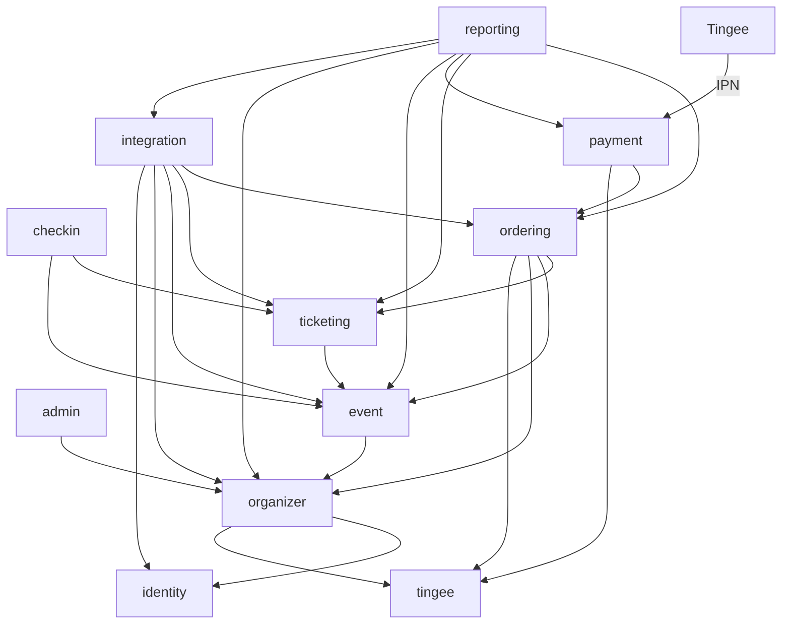
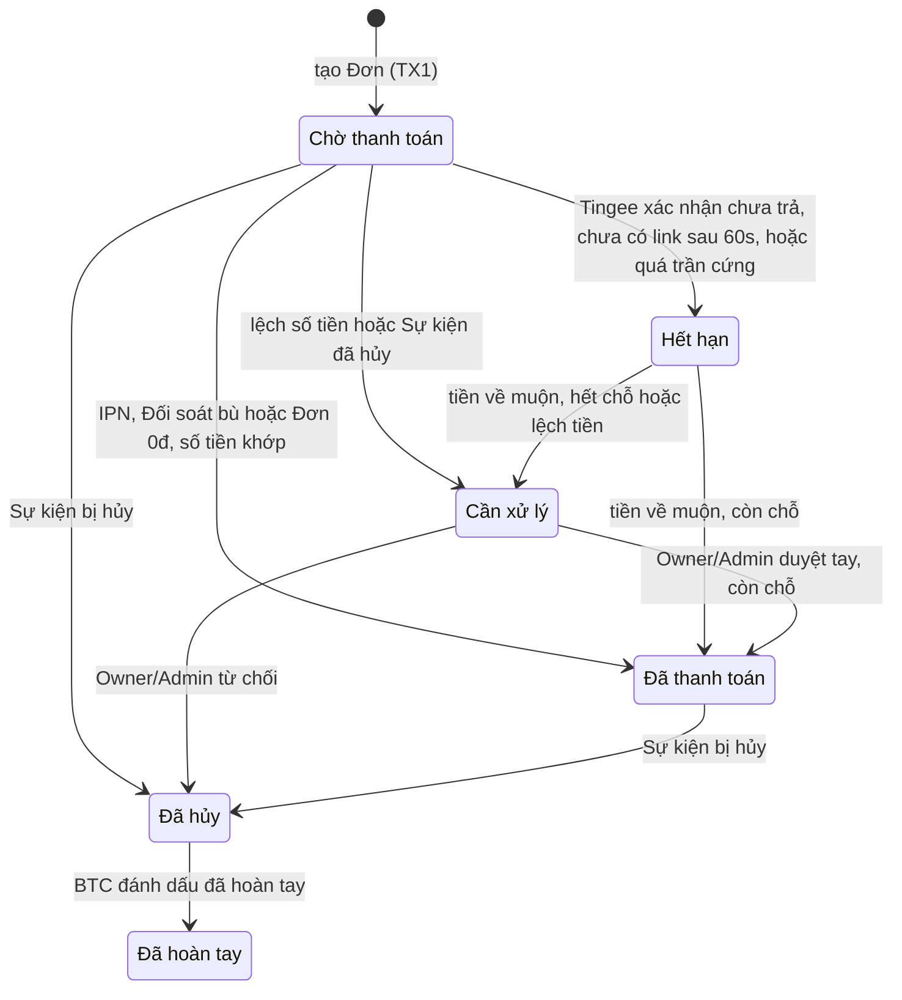
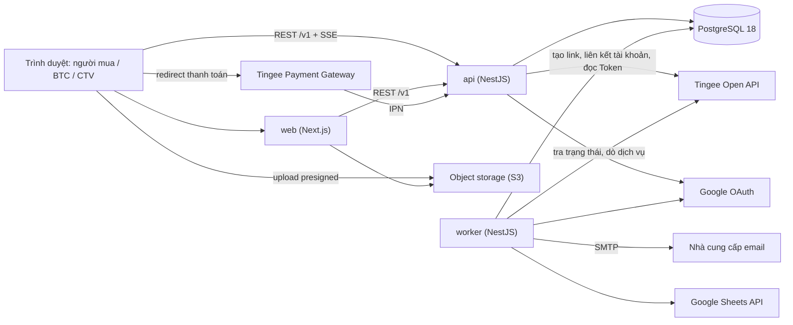
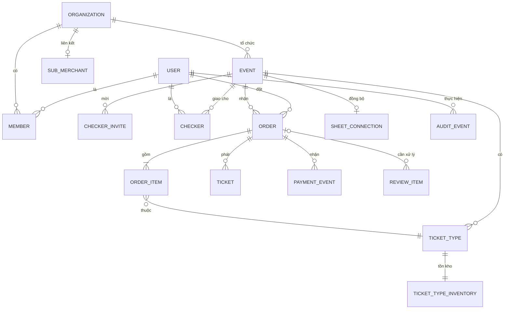

# Architecture Spine — Tickee MVP v1

## Design Paradigm

**Modular monolith.** Monorepo có hai app: `apps/web` (Next.js, chỉ giao diện) và `apps/api` (NestJS). `apps/api` build thành một image, chạy một trong ba vai theo biến môi trường: **api** (HTTP: REST `/v1`, IPN, SSE), **worker** (job và lịch pg-boss), **migrate** (chạy migration Drizzle và khởi tạo pg-boss rồi thoát). Trong `apps/api`, mỗi mô-đun miền sở hữu bảng và trạng thái của mình (AD-10). Luồng ghi chạm nhiều mô-đun trong một transaction nằm ở tầng **flows** (AD-25).

| Mô-đun (`apps/api/src/modules/…`) | Sở hữu |
| --- | --- |
| `identity` | Tài khoản Tickee, session, OTP, TOTP và step-up, đồng ý NĐ 13, xóa tài khoản |
| `organizer` | BTC, thành viên và vai trò, Merchant con và trạng thái liên kết tài khoản nhận tiền, Closed Beta, trạng thái dịch vụ thanh toán, ngưỡng cảnh báo Token, khóa BTC, kênh liên hệ BTC |
| `event` | Sự kiện, Hạng vé (giá, thời gian bán), giới hạn Vé/Đơn, form mua vé, trạng thái Sự kiện, `effective_end_at`, khóa Sự kiện |
| `ordering` | Đơn, dòng Đơn, câu trả lời form (kèm nhãn), bản chụp người mua, mã Đơn, link Gateway, tồn kho `ticket_type_inventory`, sự kiện phễu mua |
| `payment` | `payment_events`, Đối soát bù, hàng Cần xử lý (`review_items`) |
| `ticketing` | Vé, bản chụp trên Vé, Mã QR vé, link chia sẻ Vé, trạng thái Vé và check-in |
| `checkin` | Lời mời CTV, phân công CTV theo Sự kiện, màn quét, tra tay |
| `reporting` | Dashboard, CSV, danh sách hoàn tiền, thông báo trạng thái (`notices`) — chỉ đọc |
| `integration` | Gửi email (`EmailTransport`), kết nối Google Sheets và ánh xạ dòng, danh mục thông báo |
| `admin` | Báo cáo vi phạm; endpoint của Quản trị Tingee (ghi qua `flows`) |
| `tingee` | Adapter Tingee — không sở hữu bảng |
| `platform` (shared kernel) | DB và transaction, cổng `AccessResolver` và guard quyền, `orgScope`, `audit_events`, hàng đợi job, realtime (SSE/NOTIFY), config, log |

Hướng phụ thuộc giữa các mô-đun. Mũi tên = được phép gọi service công khai hoặc đọc read model. Không vẽ: mọi mô-đun được gọi `platform`; `flows` được gọi mọi mô-đun; controller gọi một mô-đun hoặc một flow; `apps/web` chỉ gọi HTTP `/v1`.



## Invariants & Rules

### AD-1 — Vé chỉ được phát trong lần chuyển trạng thái Đơn thắng

- **Binds:** FR-11, FR-14, FR-19, FR-20, FR-21, FR-22, FR-33; `ordering`, `ticketing`, `payment`
- **Prevents:** Phát Vé trùng khi IPN, IPN lặp, Đối soát bù và duyệt tay cùng đến; phát Vé khi chưa nhận tiền; phát Vé cho Sự kiện đã hủy.
- **Rule:** Vé chỉ được tạo bên trong `ordering.markPaid(tx, orderId, source, paidAmount)`. Hàm này đọc Sự kiện `FOR SHARE`, rồi làm compare-and-set trên Đơn theo AD-3 cùng phép tồn kho tương ứng ở bảng AD-2. Kết quả trả về là một trong: `paid`, `orphan` (hết chỗ), `mismatch` (lệch số tiền), `event_cancelled`, `lost_race`. Chỉ `paid` mới phát N Vé (AD-35), enqueue email/Sheets và ghi audit, tất cả trong cùng transaction; các kết quả khác để bên gọi (`payment`) tạo `review_item` trong cùng `tx`. `source` chỉ có bốn giá trị: `ipn`, `reconciliation`, `manual` (Owner/Admin duyệt tay), `free`. Không bao giờ phát Vé từ `returnUrl`, callback SDK Tingee hay bất kỳ request nào của trình duyệt người mua.

### AD-2 — Tồn kho nằm trong PostgreSQL, mỗi chuyển trạng thái có một phép tồn kho

- **Binds:** FR-8, FR-11, FR-12, FR-13, FR-14, FR-21, NFR-3; `ordering`
- **Prevents:** Bán quá số suất; trừ `held` hai lần; hai nguồn đếm lệch nhau.
- **Rule:** Tồn kho ở `ticket_type_inventory(capacity, sold, held)` với `CHECK (held >= 0 AND sold >= 0 AND sold + held <= capacity)`, chỉ `ordering` ghi. Phép "giữ có điều kiện" là `UPDATE … SET held = held + :n WHERE ticket_type_id = :id AND sold + held + :n <= capacity`; phép "bán có điều kiện" tương tự với `sold`. Đơn nhiều Hạng vé cập nhật theo `ticket_type_id` tăng dần; một dòng trả 0 → rollback cả Đơn, lỗi nêu rõ Hạng vé hết. Không dùng Redis hay cache làm bộ đếm. Đổi số suất là `UPDATE … SET capacity = :c WHERE ticket_type_id = :id AND sold + held <= :c`. Kiểm trần 200 Vé của Sự kiện miễn phí: khóa mọi dòng tồn kho của Sự kiện `FOR UPDATE` theo thứ tự id rồi mới cộng tổng. Job đối chiếu định kỳ so `held` với số Vé của Đơn `pending` và `sold` với số Vé đã phát; lệch → cảnh báo, không tự sửa.

| Chuyển trạng thái Đơn | Phép tồn kho (cùng transaction) | Khi phép tồn kho thất bại |
| --- | --- | --- |
| tạo Đơn có phí → `pending` | giữ có điều kiện `+n` | không tạo Đơn, báo Hạng vé hết |
| tạo Đơn tổng 0đ → `pending` → `paid` (`free`) | bán có điều kiện `+n` | không tạo Đơn, báo Hạng vé hết |
| `pending` → `paid` | `held -= n`, `sold += n` | — |
| `pending` → `expired` | `held -= n` | — |
| `pending` → `review` (lệch số tiền, Sự kiện đã hủy) | `held -= n` | — |
| `pending` → `cancelled` (hủy Sự kiện) | `held -= n` | — |
| `expired` → `paid`, `review` → `paid` | bán có điều kiện `+n` | `expired` → `review` (Thanh toán mồ côi); `review` giữ nguyên, báo "hết chỗ" |
| `paid` → `cancelled`, `cancelled` → `refunded` | không đổi (chỗ không trả lại) | — |

### AD-3 — Đơn là máy trạng thái compare-and-set

- **Binds:** FR-14, FR-19, FR-20, FR-21, FR-33; `ordering`
- **Prevents:** Job hết hạn, IPN và thao tác tay ghi đè trạng thái của nhau.
- **Rule:** Chỉ `ordering` ghi `orders.status`, qua một hàm chuyển trạng thái chạy `UPDATE orders SET status=:to … WHERE id=:id AND status=:from`. Chỉ các chuyển trong sơ đồ hợp lệ. 0 dòng = thua cuộc đua → đọc lại trạng thái hiện tại và xử lý theo nó. Thao tác do thành viên BTC khởi xướng (duyệt tay, từ chối, ghép, đánh dấu hoàn tay) thêm `AND organization_id = :ctxOrg` vào câu compare-and-set, và `review_item` phải cùng `organization_id` với Đơn. TX2 gắn link chạy `WHERE status='pending' AND payment_link IS NULL`, nên đua với hết hạn (a) của AD-4 thì chỉ một bên thắng. `cancelled` mang `cancel_reason` (`rejected` | `event_cancelled`); `review` mang loại do `payment` ghi (AD-7).



### AD-4 — Nhả chỗ: xác nhận từ Tingee hoặc trần cứng

- **Binds:** FR-14, FR-17, FR-20; `ordering`, `payment`
- **Prevents:** Nhả chỗ trước khi Tingee chốt (Thanh toán mồ côi do lệch đồng hồ); giữ chỗ mãi khi Tingee không trả lời.
- **Rule:** `orders.expires_at` = `now() + 60s` khi tạo; gắn link thành công → bằng hạn link do Tingee trả về (15 phút). `pending` → `expired` khi gặp điều kiện đầu tiên trong số: (a) chưa có link và đã quá `expires_at`; (b) IPN `canceled`/`expired` hoặc tra trạng thái theo `orderId` xác nhận chưa trả; (c) quá `expires_at + 5 phút` mà vẫn chưa có xác nhận (link Gateway hết hạn thì không nhận tiền nữa). Phân công: (a) và (c) là job hoãn của `ordering` (`startAfter` = `expires_at`, `expires_at + 5 phút`), không gọi Tingee; (b) đi qua `payment` (IPN hoặc job tra trạng thái của AD-8 tại `expires_at`), `payment` gọi `ordering.markExpired(tx, …)`. Quét định kỳ cấp phút chỉ là lưới an toàn. Màn người mua: khi đồng hồ về 0 mà Đơn vẫn `pending` thì hiện "Đang xác nhận thanh toán"; chỉ hiện "Hết hạn" khi API trả `expired`.

### AD-5 — Không gọi dịch vụ ngoài bên trong transaction DB

- **Binds:** FR-5, FR-12, FR-16, FR-34, NFR-1, NFR-3; mọi mô-đun
- **Prevents:** Giữ khóa tồn kho trong lúc chờ Tingee; cạn connection pool khi đông; người mua trả tiền cho Đơn sắp bị hủy.
- **Rule:** Không có HTTP, email hay Google API nào chạy trong `db.transaction`. Tạo Đơn có phí = TX1 (giữ chỗ + Đơn `pending` chưa link) → commit → `tingee.createPaymentLink()` (timeout 5 giây) → TX2 lưu link bằng compare-and-set. Checkout URL chỉ trả cho trình duyệt sau khi TX2 commit. Tingee trả lỗi rõ ràng → người mua được thử lại cùng Đơn (`POST /v1/me/orders/:code/payment-link`) trong cửa sổ 60 giây; timeout hoặc kết quả mơ hồ → không thử lại với cùng `orderId`, chuyển `expired`, người mua tạo Đơn mới. Các lời gọi Tingee đồng bộ được phép: tạo link, liên kết tài khoản và tạo Merchant con, đọc Token, dò trạng thái dịch vụ — luôn ngoài transaction, có timeout, trả mã lỗi miền.

### AD-6 — Thanh toán qua Tingee Payment Gateway, mở bằng redirect

- **Binds:** FR-5, FR-15, FR-16, FR-17, FR-18; `ordering`, `organizer`, `tingee`, `apps/web`
- **Prevents:** Tự khớp QR tĩnh theo nội dung chuyển khoản; hai luồng thanh toán song song; popup bị Safari iOS chặn.
- **Rule:** Mỗi lần thử của một Đơn có phí tạo link `POST /v1/payment-gateway/create-link` với `merchantId` = Merchant con của BTC, `orderId` = mã Đơn (AD-20), `amount` = `orders.total_amount`, `expireInMinute` = 15, `returnUrl` = `/orders/:code` của Tickee. Web mở link bằng **redirect toàn trang**, không dùng popup `tingee.js`. Trang `/orders/:code` luôn lấy trạng thái qua REST và realtime (AD-17), không tin tham số trên URL. Không gọi API QR động/tĩnh, không tự sinh deep link. Giá Hạng vé có phí ≥ 2.000đ, kiểm khi lưu Hạng vé. Không cho liên kết tài khoản VietinBank (`970415`, mã lỗi `BANK_NOT_SUPPORTED`).

### AD-7 — IPN: xác thực trên raw body, idempotent, xử lý mọi trường hợp biên

- **Binds:** FR-19, FR-21, NFR-2, NFR-5, NFR-6, NFR-8, NFR-10; `payment`
- **Prevents:** IPN giả; IPN retry xử lý hai lần; tiền về cho một Đơn không còn chờ mà không ai biết.
- **Rule:** Endpoint IPN là public đối với guard xác thực người dùng, đọc raw body và kiểm `x-signature` = `HMAC_SHA512(x-request-timestamp + ':' + rawBody, secret)` bằng `timingSafeEqual`; sai chữ ký → từ chối và ghi lại. `x-request-timestamp` lệch quá 10 phút → từ chối. IPN hợp lệ lưu vào `payment_events` (chỉ các field trong whitelist, bỏ dữ liệu ngân hàng của người trả) với khóa unique: `providerTransactionCode` cho sự kiện thanh toán, `(orderId, status)` cho sự kiện trạng thái; trùng khóa → trả thành công, không làm gì. Ghi event và gọi `ordering` trong một transaction, trả `{"code":"00","message":"Success"}` trong dưới 5 giây. Xử lý theo bảng:

| Trường hợp | Hành động |
| --- | --- |
| `success`, Đơn `pending`/`expired`, `paidAmount` = `total_amount` | `markPaid` (AD-1) |
| `success`, `paidAmount` ≠ `total_amount` | Đơn → `review` loại `amount_mismatch`, không phát Vé |
| `success`, Sự kiện đã hủy | Đơn → `review` loại `event_cancelled`, vào danh sách hoàn tiền |
| `success`, Đơn đã `paid`/`cancelled`/`refunded` | `review_item` loại `duplicate_payment` gắn Đơn |
| `orderId` không tồn tại | lưu `payment_events` với `order_id` null, `review_item` loại `unmatched`, cảnh báo |
| `merchantId` khác `orders.sub_merchant_id` (bản chụp lúc tạo link) | từ chối xử lý, lưu và cảnh báo |
| `canceled`/`expired` | AD-4 (b) |

`review_items` do `payment` sở hữu, có `status` `open` | `resolved` và `resolution` (`approved`, `rejected`, `refunded`, `dismissed`); mỗi Đơn tối đa một mục `open` cho mỗi loại. Duyệt tay gọi `markPaid(source=manual)`; kết quả khác `paid` thì mục vẫn `open` kèm lý do. Mục `duplicate_payment` và `unmatched` chỉ kết thúc bằng `refunded` hoặc `dismissed`, không phát Vé.

### AD-8 — Đối soát bù dùng chung đường xử lý với IPN

- **Binds:** FR-20, NFR-4; `payment`, `tingee`
- **Prevents:** Hai cách hiểu khác nhau về cùng một giao dịch; mất Vé khi IPN không tới (Tingee chỉ retry 5 lần × 1 phút).
- **Rule:** Khi gắn link, enqueue job hoãn tra trạng thái đơn Gateway theo `orderId` sau 2 phút, lặp theo backoff đến khi Đơn rời `pending`; thêm một lần tra tại `expires_at`. Khi BTC được mở lại dịch vụ (AD-32), enqueue tra cho mọi Đơn còn mở của BTC. Kết quả đi qua đúng hàm xử lý IPN: cùng whitelist, cùng khóa `payment_events`, cùng bảng ở AD-7.

### AD-9 — Một adapter Tingee duy nhất

- **Binds:** FR-5, FR-15, FR-16, FR-20, FR-34, NFR-6; `tingee`
- **Prevents:** Ký request sai định dạng ở nhiều nơi; tên field Tingee lan khắp code.
- **Rule:** Chỉ mô-đun `tingee` gọi HTTP sang Tingee và biết tên field của Tingee. Adapter ký request (Gateway: timestamp UNIX ms; API Master Merchant và liên kết tài khoản: `yyyyMMddHHmmssSSS` UTC+7), gắn `merchantId`, đổi mã lỗi Tingee thành lỗi miền (gồm `MERCHANT_SUSPENDED`, `BANK_NOT_SUPPORTED`), đổi chuỗi thời gian UTC+7 thành `timestamptz`. Server đồng bộ giờ bằng NTP. Secret Tingee chỉ đọc từ env. Repo có một Tingee fake (`apps/api/test/tingee-fake`) ký IPN bằng secret test, giả lập tạo link và tra trạng thái; mọi test tự động trừ test hợp đồng dùng fake.

### AD-10 — Ranh giới mô-đun và quyền sở hữu dữ liệu

- **Binds:** tất cả; `apps/api`
- **Prevents:** Hai mô-đun cùng sửa một bảng; phụ thuộc vòng.
- **Rule:** Mỗi bảng có đúng một mô-đun sở hữu (bảng ở Design Paradigm) và chỉ mô-đun đó ghi. Mô-đun khác gọi service công khai xuất từ `modules/<name>/index.ts`, truyền `tx` để tham gia cùng transaction, hoặc đọc read model (AD-33). Ngoại lệ duy nhất cho import schema: `schema.ts` của mô-đun khác chỉ được import để khai báo khóa ngoại. Phụ thuộc theo đúng sơ đồ, không vòng; CI kiểm bằng dependency-cruiser với cấu hình sinh từ sơ đồ. Tên queue `<module>.<action>` với `module` là mô-đun xử lý.

### AD-11 — Next.js không chạm vào DB

- **Binds:** tất cả FR có giao diện; `apps/web`
- **Prevents:** Logic nghiệp vụ và truy cập dữ liệu mọc ở hai nơi.
- **Rule:** `apps/web` chỉ gọi API `/v1` (server component chuyển tiếp cookie). Web không có driver DB, không có secret Tingee, không tự quyết trạng thái Đơn hay Vé. Web chỉ render, SSR trang công khai (AD-37), sinh ảnh OG và ảnh Social Ticket Card.

### AD-12 — Hiệu ứng phụ là job, enqueue trong cùng transaction

- **Binds:** FR-7, FR-14, FR-19, FR-23, FR-32, FR-33, FR-34, NFR-5, NFR-10; mọi mô-đun
- **Prevents:** Có Vé mà mất email; gửi email cho Đơn đã rollback.
- **Rule:** Hiệu ứng phụ của một thay đổi nghiệp vụ (email, Google Sheets, cảnh báo, gọi Tingee không do người dùng chờ) là job pg-boss, enqueue bằng chính `tx` qua `fromDrizzle(tx)`. Payload job chỉ chứa id; handler chỉ ghi bảng của mô-đun xử lý (AD-10) và đọc dữ liệu khác qua read model (AD-33), nên enqueue không phải cửa sau để ghi chéo. Handler idempotent (khóa = loại job + id thực thể, thêm phiên bản thực thể khi cùng thực thể kích hoạt nhiều lần, vd. email báo đổi giờ) và tự retry; hết retry → dead-letter queue, cảnh báo NFR-10, requeue từ `/admin`. Việc theo từng Đơn dùng job hoãn; việc định kỳ dùng lịch pg-boss (độ chính xác đến phút). Mô-đun enqueue theo tên queue khai báo trong `packages/contracts`, không import mô-đun xử lý. Lệnh do người dùng chủ động cần kết quả ngay theo ngoại lệ ở AD-5.

### AD-13 — Cách ly dữ liệu giữa các BTC

- **Binds:** FR-4, FR-22, FR-26, FR-29, NFR-7, NFR-8; mọi mô-đun có dữ liệu BTC
- **Prevents:** BTC này đọc được dữ liệu BTC khác; CTV thấy dữ liệu ngoài Sự kiện được giao.
- **Rule:** Mọi bảng thuộc BTC có `organization_id NOT NULL`. Truy vấn dữ liệu BTC trong request đi qua `orgScope(ctx)`, với `ctx` do guard dựng (AD-26); CTV lọc thêm `event_id` được giao. Truy cập chéo BTC chỉ qua bốn đường có tên: `buyerScope` (theo `user_id`, chỉ Đơn/Vé của chính người mua), `shareScope` (một Vé theo share token, AD-29), `systemScope` (worker), `platformAdminScope` (mọi lần dùng ghi audit). Bộ test cách ly đi qua mọi route có decorator quyền và chạy trong CI.

### AD-14 — Quyền theo thời gian tính tại thời điểm request

- **Binds:** FR-7, FR-24, FR-26, FR-29; `event`, `checkin`, `ticketing`
- **Prevents:** Quyền CTV hay Vé còn hiệu lực chỉ vì job kết thúc Sự kiện chạy trễ; sửa giờ làm sống lại Sự kiện đã kết thúc sớm.
- **Rule:** `events.effective_end_at` = max(23:59:59 ngày kết thúc, giờ kết thúc + 6 giờ) theo `Asia/Ho_Chi_Minh`, tính lại khi sửa giờ — trừ khi `ended_manually_at` đã có: bấm "Kết thúc" sớm đặt `ended_manually_at` và `effective_end_at` = thời điểm bấm, sau đó sửa giờ không đổi `effective_end_at`. Kiểm tra quyền CTV, hiển thị Vé trong "Vé của tôi", link chia sẻ Vé và check-in đều so `now()` với giá trị này ngay tại request. Job chỉ cập nhật hiển thị và gửi thông báo.

### AD-15 — Check-in đúng một lần, không có đỏ giả

- **Binds:** FR-27, FR-28, FR-29, NFR-2; `ticketing`, `checkin`
- **Prevents:** Hai CTV cùng thấy xanh cho một Vé; CTV thấy đỏ cho chính lượt mình vừa quét khi mất phản hồi.
- **Rule:** Mọi check-in (quét hay tay) đi qua `ticketing.checkIn(tx, ticketId, eventId, userId, scanId)`. Hàm gọi `event.assertCheckinOpen(tx, eventId)` (chưa quá `effective_end_at`, không bị hủy) rồi chạy `UPDATE tickets SET checked_in_at=now(), checked_in_by=:user, checkin_scan_id=:scanId WHERE id=:id AND event_id=:event AND status='valid' AND checked_in_at IS NULL`. 0 dòng → đọc lại: cùng `scanId` → trả lại kết quả lần đầu; cùng người quét trong 60 giây → kết quả trung tính "Bạn vừa check-in Vé này"; còn lại → đỏ "đã check-in lúc X bởi Y" hoặc "vé không hợp lệ" theo lý do. Kết quả theo schema `ScanResult` trong `packages/contracts` (lý do: `BAD_SIGNATURE`, `CANCELLED`, `VOIDED`, `OTHER_EVENT`, `EXPIRED`, `CHECKER_REVOKED`, `EVENT_ENDED`). Response quét và tra tay không bao giờ chứa Mã QR vé. Client timeout 3 giây → hiện `offline-banner`, thử lại cùng `scanId`.

### AD-16 — Định dạng Mã QR vé

- **Binds:** FR-22, FR-25, FR-27, NFR-6; `ticketing`
- **Prevents:** Mã QR vé giả hoặc đoán được; mã lộ thông tin cá nhân.
- **Rule:** Nội dung `t<k>.<ticketId>.<sig>`, với `sig` = base64url(HMAC-SHA256(key_k, `t<k>.<ticketId>`)). Khóa đánh số phiên bản `k` (env), giữ khóa cũ để verify khi xoay vòng. Không chứa thông tin cá nhân. Khi quét: kiểm chữ ký trước, rồi tra DB (AD-15). Ảnh Social Ticket Card không chứa mã.

### AD-17 — Realtime chỉ là tín hiệu, REST là sự thật

- **Binds:** FR-18, FR-30, NFR-2; `platform`, `apps/web`
- **Prevents:** Màn hình kẹt ở trạng thái cũ khi Safari cắt kết nối; tín hiệu của BTC này lọt sang BTC khác.
- **Rule:** `realtime.notify(tx, topic, ids)` phát Postgres `NOTIFY` trong cùng transaction với thay đổi; không `NOTIFY` trong TX1 giữ chỗ. Payload chỉ gồm `{type, id, organizationId, eventId}`. Mỗi instance api giữ một kết nối `LISTEN` riêng, đẩy SSE cho người đăng ký sau khi lọc theo phạm vi của họ; heartbeat mỗi 25 giây. Danh mục topic khai báo trong `packages/contracts`:

| Topic | Ai được đăng ký | REST cần tải lại |
| --- | --- | --- |
| `order_changed` | Người mua của Đơn (`buyerScope`) | `GET /v1/me/orders/:code` |
| `event_orders_changed` | Owner, Admin | Đơn gần đây, số liệu Sự kiện |
| `event_checkins_changed` | Owner, Admin, CTV được giao | Số liệu check-in |
| `org_review_items_changed` | Owner, Admin | Số mục Cần xử lý |
| `org_status_changed` | Thành viên BTC | `notices`, vai trò |

Client dùng một hook duy nhất: gọi REST khi kết nối, khi nhận tín hiệu (gom trong 1 giây) và khi `visibilitychange` sang visible; không có SSE thì polling 2 giây ở màn chờ thanh toán, 10 giây ở dashboard.

### AD-18 — Audit ghi trong cùng transaction, không chứa thông tin cá nhân

- **Binds:** FR-2, FR-7, FR-21, FR-26, FR-35, FR-37, FR-38, NFR-8, NFR-11; mọi mô-đun
- **Prevents:** Thay đổi đã xảy ra mà không có nhật ký; nhật ký chỉ-append giữ thông tin cá nhân không xóa được.
- **Rule:** `audit_events` chỉ cho INSERT (role DB `tickee_app` không có UPDATE/DELETE trên bảng này), ghi qua `audit.record(tx, …)` gồm actor, `organization_id` (nullable cho thao tác cấp nền tảng), hành động, đối tượng, và danh sách tên trường đã đổi — chỉ id và tên trường, không ghi giá trị cá nhân. Bắt buộc cho: thay đổi Sự kiện, phân quyền và CTV, xử lý hàng Cần xử lý, đánh dấu hoàn tay, duyệt/thu hồi Closed Beta, khóa/mở khóa, vô hiệu Vé, mọi truy cập của Quản trị Tingee.

### AD-19 — Danh tính và session

- **Binds:** FR-1, FR-3, NFR-6; `identity`
- **Prevents:** Hai cơ chế đăng nhập; cùng một email thành hai tài khoản.
- **Rule:** Better Auth trong `identity`, gắn vào NestJS qua `@thallesp/nestjs-better-auth`, là nơi duy nhất cấp session: Google và `emailOTP` (hiệu lực 5 phút, `allowedAttempts` = 5, OTP lưu dạng hash); cùng email = một Tài khoản Tickee. ID sinh UUIDv7, cột snake_case theo quy ước. Session lưu DB; cookie `httpOnly`, `Secure`, `SameSite=Lax` trên domain cha; API ở `api.<domain>`, CORS chỉ cho origin web. Raw body cho IPN lấy qua `AuthModule.forRoot({ bodyParser: { rawBody: true } })`. Lựa chọn Vé trước khi đăng nhập giữ trong URL (`returnTo`) để quay lại đúng Hạng vé và số lượng (FR-3). Vai trò và step-up: AD-26.

### AD-20 — Mã Đơn

- **Binds:** FR-12, FR-21, FR-31, FR-32, FR-33; `ordering`
- **Prevents:** Mỗi nơi hiển thị một mã khác nhau cho cùng một Đơn; mã không dùng được làm `orderId` của Gateway.
- **Rule:** Mã Đơn = `TK` + 8 ký tự Crockford base32 ngẫu nhiên (không có I, L, O, U), unique, chỉ `ordering` sinh; trùng khóa unique → sinh lại, tối đa 3 lần. Đây là `orderId` gửi Gateway và là mã duy nhất hiển thị cho người mua, BTC, CSV và Sheets. Không đưa id nội bộ ra ngoài thay cho mã Đơn.

### AD-21 — Trạng thái bán có một nguồn duy nhất

- **Binds:** FR-5, FR-7, FR-8, FR-10, FR-15, FR-35, FR-37; `ordering`
- **Prevents:** Trang Sự kiện hiện "đang bán" nhưng tạo Đơn bị từ chối, hoặc ngược lại.
- **Rule:** `ordering.sellability(eventId)` là nguồn duy nhất trả trạng thái bán theo Hạng vé và một `eventReason` cấp Sự kiện (Đang bán / Chưa mở bán / Đã đóng bán / Hết vé / Tạm ngừng bán / Ẩn / Bị khóa / Đã hủy / Đã kết thúc). Hàm xét: trạng thái và khóa Sự kiện, khóa BTC, Closed Beta và liên kết tài khoản (chỉ với Hạng vé > 0đ), chính sách hoàn vé, cửa sổ bán, tồn kho, trạng thái dịch vụ thanh toán của BTC (AD-32, chỉ với Hạng vé > 0đ), giới hạn Vé/Đơn. Trang công khai và tạo Đơn đều gọi hàm này; tạo Đơn kiểm lại trong TX1.

### AD-22 — Hạ tầng không phụ thuộc nhà cung cấp

- **Binds:** NFR-4, NFR-5, NFR-10; vận hành
- **Prevents:** Code bị trói vào một cloud trước khi có ý kiến pháp lý về nơi lưu dữ liệu.
- **Rule:** Deploy bằng image Docker (`web`, `api`; `api` chạy vai `api`, `worker` hoặc `migrate`). PostgreSQL 18 chuẩn, có PITR và failover tự động, cho kết nối session trực tiếp cho `LISTEN` và pg-boss (pooler chế độ transaction chỉ đứng trước truy vấn thường). Ảnh lưu trên object storage tương thích S3, upload bằng presigned URL, bucket ảnh bật CORS `GET` cho origin web. Gửi email qua interface `EmailTransport` (SMTP mặc định; Mailpit ở local). Code không dùng dịch vụ độc quyền của cloud nào.

### AD-23 — Google Sheets đồng bộ một chiều theo mã Đơn

- **Binds:** FR-32; `integration`
- **Prevents:** Ghi đè sai dòng khi BTC chèn, xóa hay sắp xếp lại Sheet; dùng token của người đã rời BTC.
- **Rule:** Mỗi Sự kiện có tối đa một kết nối Sheet, do Owner/Admin tạo bằng OAuth riêng với scope `drive.file`. Refresh token mã hóa AES-GCM, khóa có phiên bản (ciphertext tiền tố `v<k>:`). Người cấp OAuth bị xóa khỏi BTC → kết nối chuyển `auth_revoked`. Mỗi thay đổi Đơn (`paid`, `review`, `cancelled`, `refunded`) và mỗi check-in enqueue `integration.sheet_row_changed {eventId, orderId}`; handler đánh dấu dòng bẩn trong bảng của `integration`. Job flush theo Sự kiện (singleton, tối đa một lần mỗi phút) ghi mọi dòng bẩn rồi xóa đánh dấu sau khi ghi thành công, nên không mất thay đổi khi throttle: tìm dòng theo cột mã Đơn, thiếu thì thêm; chỉ ghi các cột Tickee quản lý. Trạng thái kết nối: `active` | `syncing` | `retrying` | `auth_revoked`, kèm `last_synced_at`, `last_error_code`; chỉ `auth_revoked` sinh thông báo cho BTC.

### AD-24 — Dữ liệu cá nhân và xóa tài khoản

- **Binds:** FR-38, NFR-8; mọi mô-đun
- **Prevents:** Mỗi mô-đun xóa dữ liệu một kiểu; lộ thông tin cá nhân qua log.
- **Rule:** Không lưu thông tin ngân hàng của người mua. Log che SĐT và email. Danh sách cột chứa thông tin cá nhân của từng mô-đun khai báo trong `packages/contracts`. Xóa Tài khoản Tickee hoặc rút lại đồng ý = `flows.deleteAccount()`: `identity` vô hiệu đăng nhập và enqueue `<module>.anonymize_user` cho từng mô-đun có cột cá nhân; không xóa cứng Đơn, `payment_events` hay `audit_events`. Vé đã phát vẫn check-in được bằng mã nhưng không còn tra tay được. Từ chối xóa khi người dùng đang là Owner của một BTC (phải chuyển Owner trước) hoặc còn Đơn `pending`. Trước khi xóa, web cảnh báo nếu còn Vé hợp lệ của Sự kiện chưa diễn ra.

### AD-25 — Tầng `flows` điều phối luồng ghi nhiều mô-đun

- **Binds:** FR-8, FR-33, FR-35, FR-38; `apps/api/src/flows`
- **Prevents:** Phụ thuộc vòng; mỗi người build tự lách ranh giới mô-đun theo một kiểu khi một luồng phải ghi nhiều mô-đun trong một transaction.
- **Rule:** Luồng ghi chạm từ hai mô-đun trở lên trong một transaction nằm ở `flows/`, mở `tx` và gọi service công khai của từng mô-đun. Mô-đun không bao giờ gọi `flows`. Danh sách flow MVP: `createTicketType` (event + tồn kho ordering, kiểm trần 200 Vé với Sự kiện miễn phí), `changeCapacity`, `cancelEvent` (AD-28), `lockEvent`/`lockOrganization` và `voidTickets` (AD-28), `deleteAccount` (AD-24), `acceptCheckerInvite` (AD-30).

### AD-26 — Kiểm soát truy cập

- **Binds:** FR-2, FR-4, FR-26, FR-29, NFR-6, NFR-7; `platform`, `organizer`, `checkin`, `identity`, `admin`
- **Prevents:** Mỗi mô-đun tự truy vấn vai trò theo một kiểu; Admin làm được việc chỉ Owner được làm; Owner xem PII mà chưa qua 2FA.
- **Rule:**
  - `platform` định nghĩa cổng `AccessResolver` và decorator `@RequirePermission(perm)`; `organizer` và `checkin` cài đặt cổng (đăng ký lúc khởi động). Guard dựng `ctx = { userId, organizationId, role, assignedEventIds, stepUpAt }` trước controller; không mô-đun nào tự truy vấn vai trò.
  - Enum quyền và ma trận FR-4 khai báo một lần trong `packages/contracts`. Mọi endpoint của BTC nằm dưới `/v1/orgs/:orgId/…`; endpoint của CTV nằm dưới `/v1/checkin/events/:eventId/…`.
  - Mỗi BTC có đúng một Owner: unique index một phần `members(organization_id) WHERE role='owner'`.
  - TOTP: trở thành Owner yêu cầu đăng ký TOTP (Better Auth `twoFactor`, `allowPasswordless: true`). Mọi request với vai Owner, và mọi request của Quản trị Tingee, yêu cầu step-up TOTP trong session còn hiệu lực (12 giờ; Quản trị Tingee: mỗi session); thiếu → `TOTP_REQUIRED`. Step-up do `identity` tự dựng vì Better Auth không hỏi TOTP khi đăng nhập bằng Google hay OTP email.
  - Mã lỗi quyền: `NOT_A_MEMBER`, `FORBIDDEN_ROLE`, `TOTP_REQUIRED`, `CHECKER_REVOKED`, `EVENT_ENDED`. `GET /v1/me/memberships` trả vai trò của người dùng ở từng BTC.
  - Quản trị Tingee: cờ `platform_admin`, mọi route `/v1/admin/*` giới hạn IP tại API (cấu hình trusted proxy để lấy đúng IP); giới hạn ở `/admin` của web chỉ là lớp phụ.

### AD-27 — Máy trạng thái Sự kiện và Vé

- **Binds:** FR-7, FR-24, FR-33, FR-35; `event`, `ticketing`
- **Prevents:** "Bị khóa" lẫn vào trạng thái nên mở khóa không biết quay về đâu; hai cách hiểu "Đã kết thúc".
- **Rule:** `events.status` lưu `draft` → `published` ↔ `hidden`; `published`/`hidden` → `cancelled`; chuyển bằng compare-and-set như AD-3. "Đã kết thúc" không lưu, luôn tính từ `effective_end_at` (AD-14). Khóa là trục riêng: `locked_at`, `locked_by`, `lock_reason` trên `events` và trên `organizations`; mở khóa không đụng `status`. Sự kiện `draft` và slug sai trả cùng `404 EVENT_NOT_FOUND`. Vé: `valid` → `cancelled` với `cancel_reason` (`event_cancelled` | `voided`); check-in là `checked_in_at` trên Vé `valid`; Vé đã check-in vẫn chuyển `cancelled` khi Sự kiện bị hủy.

### AD-28 — Hủy và khóa Sự kiện

- **Binds:** FR-33, FR-35, FR-37; `flows`, `event`, `ordering`, `ticketing`
- **Prevents:** Vé hợp lệ được phát hoặc còn quét xanh cho Sự kiện đã hủy; danh sách hoàn tiền thiếu người trả tiền sau khi hủy.
- **Rule:** `flows.cancelEvent` trong một transaction: khóa dòng Sự kiện `FOR UPDATE` và chuyển `cancelled`; Đơn `pending` → `cancelled` (nhả chỗ); Đơn `paid` → `cancelled` với `cancel_reason = event_cancelled`; mọi Vé `valid` → `cancelled`; enqueue email cho người mua. Tiền về sau đó đi theo AD-7 (`review` loại `event_cancelled`). Danh sách hoàn tiền là truy vấn động: mọi Đơn có `paid_amount` > 0 thuộc Sự kiện, chưa `refunded`. Khóa Sự kiện hoặc BTC chỉ chặn bán (AD-21); Đơn `pending` vẫn được trả tiền và phát Vé. `flows.voidTickets` (Quản trị Tingee chọn vô hiệu) chuyển Vé `valid` → `cancelled` với `cancel_reason = voided`, ghi audit.

### AD-29 — Link chia sẻ Vé

- **Binds:** FR-22, FR-23, UJ-1; `ticketing`
- **Prevents:** Mỗi người build tự mở một đường công khai `/tickets/:id` đoán được và không hết hạn.
- **Rule:** Mỗi Vé có `share_token` ngẫu nhiên 128 bit, DB chỉ lưu hash; chủ Vé tạo lại được, tạo lại thì link cũ mất hiệu lực. `GET /v1/shared-tickets/:token` không cần đăng nhập (`shareScope`), trả Mã QR vé, tên Sự kiện, Hạng vé, số thứ tự Vé và trạng thái; không trả SĐT, email hay tên người mua. Token sai, Vé đã hủy hoặc quá `effective_end_at` → `404` chung. Email gửi Vé (FR-23) dùng link này. Người nhận link không thấy Vé trong "Vé của tôi" của mình.

### AD-30 — Lời mời CTV

- **Binds:** FR-26; `checkin`
- **Prevents:** CTV đã bị thu hồi mở lại link chung còn hạn và tự nhận lời mời lần nữa.
- **Rule:** `checker_invites(event_id, token_hash, expires_at, revoked_at)`: mỗi Sự kiện tối đa một link đang hoạt động, tạo link mới thì link cũ bị thu hồi; hạn = min(7 ngày, `effective_end_at`); token ngẫu nhiên 128 bit. `checkers(event_id, user_id, status active|revoked, revoked_by, revoked_at)`. Nhận lời mời bắt buộc đăng nhập; nếu đã có bản ghi `revoked` thì trả `CHECKER_REVOKED` và không kích hoạt lại — chỉ Owner/Admin bấm "khôi phục". Màn xem trước lời mời chỉ trả tên Sự kiện và tên BTC. Mọi thao tác ghi audit.

### AD-31 — Chống trùng request

- **Binds:** FR-12, FR-13, FR-21, FR-27, FR-29, NFR-3; `ordering`, `payment`, `checkin`
- **Prevents:** Mạng chập chờn sinh hai Đơn giữ gấp đôi chỗ; bấm hai lần ra hai thao tác.
- **Rule:** Mọi `POST` tạo tài nguyên hoặc đổi trạng thái từ trình duyệt (tạo Đơn, thao tác Cần xử lý, đánh dấu hoàn tay, check-in tay) nhận header `Idempotency-Key` (UUID do client sinh). Tạo Đơn: `UNIQUE (user_id, idempotency_key)` trên `orders`; request trùng khóa trả Đơn đã có với trạng thái hiện tại và link nếu có. Mỗi người mua tối đa một Đơn `pending` cho mỗi Sự kiện (unique index một phần). Quét dùng `scanId` theo AD-15. Giới hạn tốc độ tạo Đơn và tra tay theo user và IP, đếm trong Postgres.

### AD-32 — Trạng thái dịch vụ thanh toán của BTC

- **Binds:** FR-15, FR-20, FR-34, FR-37; `organizer`, `tingee`, `payment`
- **Prevents:** "Tạm ngừng bán" kẹt mãi vì không ai tắt; Đối soát bù sau khi mở lại dịch vụ không bao giờ chạy.
- **Rule:** `organizer` sở hữu `payment_service_status` của BTC (`active` | `suspended`, `reason` `token` | `tingee_disabled`, `since`, `last_checked_at`) và `token_alert_threshold`. Bật `suspended` khi adapter trả `MERCHANT_SUSPENDED` (trong transaction bù của AD-5). Tắt bằng: job dò `tingee.getMerchantServiceStatus()` mỗi 5 phút khi đang `suspended`, nút "Kiểm tra lại" của Owner, hoặc Quản trị Tingee. Tắt cờ → enqueue Đối soát bù cho mọi Đơn còn mở của BTC (AD-8). Thu hồi Closed Beta là trường riêng (`closed_beta_status`), không dùng cờ này. Số dư và hạn mức Token đọc trực tiếp từ Tingee mỗi lần xem (timeout 3 giây, lỗi → "Chưa đọc được số dư"), không lưu.

### AD-33 — Read model cho đọc chéo mô-đun

- **Binds:** FR-21, FR-30, FR-31, FR-32, FR-33; `reporting`, `integration`, `admin`, mô-đun sở hữu dữ liệu
- **Prevents:** Dashboard và CSV join thẳng bảng của mô-đun khác, hoặc gọi service gây N+1.
- **Rule:** Mô-đun sở hữu xuất read model chỉ đọc: view SQL `<module>_read_*` (migration của mô-đun đó) hoặc hàm query trong `index.ts`. `reporting`, `integration` và `admin` chỉ đọc dữ liệu mô-đun khác qua read model, không ghi. Đổi cột của bảng không được làm vỡ view mà không sửa view trong cùng migration.

### AD-34 — Thông báo trạng thái và điều kiện mở bán

- **Binds:** FR-5, FR-7, FR-15, FR-32, FR-33, FR-34, FR-37; `reporting`, `event`
- **Prevents:** Web tự ghép banner từ nhiều endpoint với logic riêng; nút "Mở bán" và backend xét điều kiện khác nhau.
- **Rule:** `reporting.notices(scope)` là nguồn duy nhất cho `status-banner`, trả `[{code, severity, blocking, dismissible, scope: org|event, audience, data, version}]`; enum `code` và thứ tự ưu tiên khai báo trong `packages/contracts`, web chỉ ánh xạ `code` sang nội dung. `event.publishReadiness(eventId)` trả `[{code, satisfied}]` cho các điều kiện **chặn mở bán** (chính sách hoàn vé; với Hạng vé > 0đ: Closed Beta, liên kết tài khoản, giá ≥ 2.000đ; BTC không bị khóa); lệnh mở bán gọi lại đúng hàm này. Trạng thái dịch vụ thanh toán và khóa Sự kiện chỉ làm "Tạm ngừng bán" sau khi đã mở bán (AD-21), không chặn mở bán.

### AD-35 — Bản chụp dữ liệu trên Đơn và Vé

- **Binds:** FR-8, FR-9, FR-12, FR-27, FR-29, FR-31, NFR-8; `ordering`, `ticketing`
- **Prevents:** Đổi giá làm IPN đúng bị xếp nhầm vào lệch tiền; người dùng sửa hồ sơ làm lệch dữ liệu BTC đã có; tra cứu SĐT trên toàn hệ thống.
- **Rule:** TX1 ghi bất biến: `order_items.unit_price`, `orders.total_amount`, tên, SĐT (E.164), email người mua, và câu trả lời form kèm nhãn câu hỏi lúc đặt. `orders.sub_merchant_id` chụp lúc tạo link, nên đổi tài khoản nhận tiền không ảnh hưởng Đơn đang mở. `orders.paid_amount` và `paid_at` (thời điểm Tingee báo) ghi khi tiền về. `markPaid` ghi lên mỗi Vé: `seq` (1..N, `UNIQUE (order_id, seq)`), `order_ticket_count`, `holder_name`, `ticket_type_name`, `order_code`, `issued_at`. Màn BTC, CSV, Sheets, kết quả quét và tra tay chỉ đọc bản chụp này, trong `orgScope` và `event_id`. Tra tay khớp **đầy đủ** sau chuẩn hóa (E.164, email chữ thường), trả `{ticketId, holderName, ticketTypeName, seq, count, checkedIn}`, không log giá trị đã tra.

### AD-36 — Vận hành: CI/CD, topology, job, sao lưu, secret

- **Binds:** NFR-4, NFR-5, NFR-6, NFR-10; vận hành
- **Prevents:** Mỗi story tự dựng pipeline một kiểu; deploy làm mất IPN hay SSE; không khôi phục được khi cần.
- **Rule:**
  - CI: GitHub Actions trên mỗi PR chạy typecheck, dependency-cruiser (AD-10), Vitest với Postgres thật, bộ test cách ly (AD-13), Playwright với Tingee fake. Image gắn tag theo commit SHA. Staging tự deploy từ `main`; production deploy thủ công theo tag. Migration chạy bằng vai `migrate` của cùng image, trước khi đổi phiên bản `api`/`worker`, và luôn tương thích ngược.
  - Topology tối thiểu: ≥ 2 instance `api` sau load balancer, ≥ 1 instance `worker`. `/healthz` (liveness), `/readyz` (DB và `LISTEN`). Nhận `SIGTERM`: ngừng nhận SSE mới, đóng SSE đang mở, `boss.stop({ graceful })`.
  - Sao lưu: RPO ≤ 5 phút, RTO ≤ 1 giờ, giữ 14 ngày, diễn tập khôi phục trước Closed Beta.
  - Secret tiêm từ secret store của nền tảng; tên và danh sách biến cố định trong schema Zod của `config`. Hai role DB: `tickee_migrator` (DDL), `tickee_app` (DML). drizzle-kit bỏ qua schema `pgboss`.
  - Môi trường `local`, `staging`, `production` mỗi nơi một bộ credential Tingee riêng (UAT/UAT/PROD); local không nhận IPN thật, dùng Tingee fake. Test hợp đồng với Tingee UAT chạy ở staging.

### AD-37 — Trang Sự kiện công khai khi đông người

- **Binds:** FR-10, NFR-1, NFR-3; `apps/web`, `ordering`
- **Prevents:** Cache cả trang làm sai "Còn N vé"; 5.000 lượt xem cùng lúc đều đánh vào DB.
- **Rule:** Phần nội dung tĩnh SSR có cache (revalidate 30 giây, revalidate ngay khi BTC sửa Sự kiện). Số chỗ và trạng thái bán lấy từ `GET /v1/events/:slug/availability` (gọi `sellability`, cache tối đa 2 giây), gọi lúc tải trang và khi `visibilitychange`. Tạo Đơn luôn kiểm lại trong TX1.

## Consistency Conventions

| Concern | Convention |
| --- | --- |
| Thuật ngữ trong code | Tài khoản Tickee = `user`; BTC = `organization`; Owner/Admin = `member.role` `owner`/`admin`; CTV = `checker`; Sự kiện = `event`; Hạng vé = `ticket_type`; Đơn = `order`; dòng Đơn = `order_item`; Vé = `ticket`; Giữ chỗ = `hold`; Cần xử lý = `review_item`; Đối soát bù = `reconciliation`; Merchant con = `sub_merchant`; Quản trị Tingee = `platform_admin` |
| Loại `review_item` | `amount_mismatch`, `orphan`, `event_cancelled`, `duplicate_payment`, `unmatched` |
| Đặt tên | Bảng và cột `snake_case`, tên bảng số nhiều; TypeScript `camelCase`; thư mục mô-đun `kebab-case`; mã lỗi miền `UPPER_SNAKE` khai báo trong `packages/contracts`; queue `<module xử lý>.<action>`; topic realtime theo AD-17 |
| ID | Khóa chính UUIDv7 (`uuidv7()` của PG 18, Better Auth cấu hình sinh UUIDv7); mã Đơn theo AD-20 |
| Tiền | `bigint` theo đồng, không dùng số thực; tổng tiền chỉ tính ở server, từ bản chụp (AD-35) |
| Thời gian | Lưu `timestamptz` (UTC); tính theo lịch với `Asia/Ho_Chi_Minh`; API trả ISO 8601 có offset; response có hạn chót kèm `serverNow` |
| API | REST JSON dưới `/v1`; request/response là schema Zod trong `packages/contracts`, dùng chung web và api; lỗi `{ "error": { "code", "message", "details" } }`; phân trang `cursor` + `limit`; header `x-request-id`, `Idempotency-Key` (AD-31) |
| Trạng thái cho người mua | Schema `BuyerOrderView` với `buyerStatus` `awaiting_payment` / `confirming` / `under_review` / `paid` / `expired` / `cancelled_by_organizer` / `event_cancelled`; không lộ loại Cần xử lý hay số tiền lệch |
| Transaction | `db.transaction(async (tx) => …)`; service nhận `tx`; mức cô lập READ COMMITTED, an toàn đồng thời dựa vào UPDATE có điều kiện và khóa dòng có thứ tự (không dựa SERIALIZABLE) |
| Web | Route groups `(public)`, `(buyer)`, `(dashboard)`, `(checkin)`, `(admin)`; API client typed sinh từ `packages/contracts`; TanStack Query phía client; một hook `useLiveResource` cho SSE, `visibilitychange` và polling (AD-17); UI dùng shadcn/ui trên Tailwind theo DESIGN.md |
| Thông báo | Danh mục trong `packages/contracts`: loại, sự kiện kích hoạt, người nhận, kênh, khóa chống gửi lặp (vd. cảnh báo Token: Owner, email + banner, khóa `(organization, lần vượt ngưỡng)`) |
| Cấu hình và secret | Biến môi trường kiểm bằng Zod khi khởi động; secret không nằm trong repo; khóa mã hóa và khóa ký có phiên bản |
| Log | pino JSON (`nestjs-pino`), kèm `requestId`, `organizationId`, mã Đơn; che SĐT/email; không log secret hay chữ ký |
| Giám sát | OpenTelemetry cho trace và metrics; cảnh báo khi IPN lỗi, tỉ lệ phát Vé giảm bất thường, hàng đợi pg-boss ùn hoặc có dead-letter, Đơn `pending` quá hạn chưa xác nhận, p95 tạo link > 2 giây |
| Đo lường sản phẩm | Cột thời gian bắt buộc: `orders.created_at`, `paid_at`, `tickets.issued_at`; bảng `checkout_funnel_events` không PII (`buy_clicked`, `login_completed`, `order_created`, `paid`) để đo SM-2, SM-3, SM-C2, SM-C3 |
| Kiểm thử | Vitest với Postgres thật (container); Playwright E2E, gồm thanh toán khi tab ở nền và quét khi mất phản hồi; bộ test cách ly BTC; test hợp đồng với Tingee UAT ở staging |

## Stack

| Name | Version |
| --- | --- |
| Node.js | 26 (Active LTS; ≥ 26.12.1) |
| pnpm | 12.15.0 (cài riêng, Node 25+ không kèm Corepack) |
| Turborepo | 2.11.10 |
| TypeScript | 6.0.3 |
| Next.js | 16.4.3 |
| React | 19.3.1 |
| Tailwind CSS | 4.3.3 |
| TanStack Query | 5.105.0 |
| NestJS (`@nestjs/core`, `@nestjs/platform-express`) | 12.3.2 |
| Zod | 4.6.7 |
| PostgreSQL | 18.6 |
| Drizzle ORM | 0.45.4 |
| drizzle-kit | 0.31.11 |
| node-postgres (`pg`) | 8.23.1 |
| pg-boss | 12.38.0 |
| Better Auth | 1.7.14 |
| `@thallesp/nestjs-better-auth` | 2.8.0 |
| pino / `nestjs-pino` | 10.4.0 / 5.3.1 |
| OpenTelemetry (`@opentelemetry/api` / `sdk-node`) | 1.10.0 / 0.300.0 |
| `@googleapis/sheets` | 18.1.1 |
| `@aws-sdk/client-s3` | 3.1158.0 |
| nodemailer | 10.2.1 |
| dependency-cruiser | 18.7.0 |
| Vitest | 5.0.5 |
| Playwright | 1.64.1 |
| Tingee Open API (Payment Gateway, Master Merchant, Webhook) | v1 |

## Structural Seed

```text
tickee/
  apps/
    web/                    # Next.js: (public) trang Sự kiện, (buyer) mua Vé + Vé của tôi + /orders/:code,
                            # (dashboard) BTC, (checkin) màn quét, (admin) Quản trị Tingee
    api/
      src/
        modules/            # identity, organizer, event, ordering, payment, ticketing,
                            # checkin, reporting, integration, admin, tingee
        flows/              # luồng ghi nhiều mô-đun (AD-25)
        platform/           # db + tx, access (AccessResolver, guard), audit, jobs, realtime, config, logging
        main.ts             # vai chạy theo env: api | worker | migrate
      drizzle/              # migration
      test/tingee-fake/     # Tingee giả lập cho test và local
  packages/
    contracts/              # schema Zod, mã lỗi, quyền, topic, queue, notices, thông báo, cột PII
  docker-compose.yml        # local: Postgres 18, Mailpit
```

Container và tích hợp ngoài:



Môi trường:

| Môi trường | Tingee | Ghi chú |
| --- | --- | --- |
| `local` | Tingee fake (UAT khi cần thử tay) | docker compose: Postgres 18, Mailpit |
| `staging` | UAT (`https://uat-open-api.tingee.vn`) | Tự deploy từ `main`; test hợp đồng Tingee, kiểm thử tải NFR-3 |
| `production` | PROD (`https://open-api.tingee.vn`) | Deploy thủ công theo tag; migration chạy trước, tương thích ngược |

Thực thể chính:



## Capability → Architecture Map

| Capability / Area | Lives in | Governed by |
| --- | --- | --- |
| Tài khoản, đăng nhập, xóa tài khoản (FR-1, FR-3, FR-38) | `identity`, `flows` | AD-19, AD-24, AD-26 |
| BTC, thành viên, phân quyền (FR-2, FR-4) | `organizer`, `platform` | AD-13, AD-18, AD-26 |
| Liên kết tài khoản nhận tiền, Closed Beta, KYC (FR-5, FR-6, FR-37) | `organizer`, `tingee` | AD-5, AD-6, AD-9, AD-34 |
| Sự kiện, Hạng vé, form, trang công khai, miễn phí (FR-7–FR-11) | `event`, `ordering`, `flows`, `apps/web` | AD-2, AD-14, AD-25, AD-27, AD-34, AD-37 |
| Checkout, Giữ chỗ, hết hạn (FR-12–FR-14) | `ordering` | AD-2, AD-3, AD-4, AD-5, AD-20, AD-31, AD-35 |
| Token, Tạm ngừng bán (FR-15, FR-34) | `organizer`, `tingee`, `integration` | AD-9, AD-21, AD-32 |
| Thanh toán qua Gateway, màn Thành công (FR-16–FR-18) | `ordering`, `apps/web` | AD-4, AD-6, AD-17 |
| IPN, Đối soát bù, Cần xử lý (FR-19–FR-21) | `payment` | AD-1, AD-3, AD-7, AD-8 |
| Vé, Vé của tôi, link chia sẻ, email, Social Ticket Card (FR-22–FR-25) | `ticketing`, `integration`, `apps/web` | AD-1, AD-12, AD-14, AD-16, AD-29, AD-35 |
| Check-in, CTV, tra tay, thời gian thực (FR-26–FR-30) | `checkin`, `ticketing` | AD-14, AD-15, AD-17, AD-30, AD-35 |
| Dashboard, CSV, Sheets (FR-31, FR-32) | `reporting`, `integration` | AD-23, AD-33, AD-34 |
| Hủy Sự kiện, danh sách hoàn tiền (FR-33) | `flows`, `reporting` | AD-27, AD-28 |
| Báo cáo vi phạm, khóa, vô hiệu Vé (FR-35) | `admin`, `flows` | AD-18, AD-26, AD-27, AD-28 |
| Dòng giới thiệu Tickee (FR-36) | `apps/web`, `integration` | — |

## Deferred

| Hạng mục | Lý do chưa chốt | Xem lại khi |
| --- | --- | --- |
| Nhà cung cấp hạ tầng, email, backend giám sát | Chờ ý kiến pháp chế về NĐ 53/2022 (lưu dữ liệu tại Việt Nam). Tiêu chí bắt buộc: AD-22 và AD-36 (PITR, failover, kết nối session, ≥ 2 instance api, RPO/RTO) | Trước Closed Beta |
| Phòng chờ (NFR-3) | Chờ Câu hỏi mở #5 của PRD; tạm có giới hạn tốc độ (AD-31) và cache trang (AD-37) | Kiểm thử tải ở staging không đạt, hoặc có Sự kiện dự kiến > 5.000 người cùng mua |
| SSO cho Quản trị Tingee | Chưa biết hệ SSO nội bộ của Tingee; tạm dùng Better Auth + step-up TOTP + giới hạn IP (AD-26) | Tingee cung cấp thông tin SSO |
| Row Level Security của Postgres | AD-13 + AD-26 đủ cho MVP; RLS là lớp phòng thủ thêm | Bộ test cách ly phát hiện lỗi |
| Thời hạn lưu dữ liệu người mua | Chờ pháp chế (PRD Câu hỏi mở #8) | Trước Closed Beta |
| Xem Vé khi mất mạng (UX OQ #13) | Mã QR vé là chuỗi tĩnh nên lưu ở client được; chưa cần cho MVP | Phản hồi từ Closed Beta |
| KYC BTC (FR-6) | Ngoài Closed Beta | Trước khi mở công khai |
| Check-in offline, app native, Zalo ZNS, OTP qua SĐT | Ngoài phạm vi MVP | Bản sau MVP |

## Open Questions

Câu hỏi cho Tingee (không chặn việc chia Epic; quy tắc hiện tại an toàn cả khi câu trả lời là "không"):

- Gọi `create-link` lần nữa với cùng `orderId` thì sao (trả link cũ, báo trùng, hay tạo link mới)? Nếu trả link cũ, AD-5 có thể cho thử lại cùng Đơn cả khi timeout.
- Tên endpoint và field của API tra trạng thái đơn Gateway theo `orderId` (AD-8); `providerTransactionCode` có ổn định giữa các lần retry và trùng với kết quả tra trạng thái không (AD-7)?
- Có API hủy link Gateway không (dùng khi hủy Sự kiện, AD-28)?
- Có API đọc trạng thái dịch vụ và Token của Merchant con không, và mã lỗi nào báo bị ngắt vì Token (AD-32)? Tingee có tự gửi cảnh báo Token cho BTC không?
- Trang Gateway hiển thị tên người nhận nào (tên BTC hay tên chủ tài khoản)? Ảnh hưởng `recipient-trust-block` của UX.
- Với Gateway, còn cần chặn VietinBank không (Gateway tự khớp, nhưng VietinBank không trả nội dung chuyển khoản)?
- IPN Gateway có gửi JSON đã minify đúng như chuỗi được ký không? Kiểm bằng test hợp đồng ở staging.

Câu hỏi sản phẩm (PM/UX):

- Doanh thu trên dashboard sau khi hủy Sự kiện tính thế nào; có cho bỏ đánh dấu "Đã hoàn tay" không (UX OQ #8)?
- BTC bị khóa còn được làm gì (UX OQ #9; mặc định hiện tại: xem Đơn, check-in, xuất CSV, không tạo hay mở bán Sự kiện)?
- Giới hạn Vé cho mỗi Tài khoản Tickee trong một Sự kiện (PRD Câu hỏi mở #2); giới hạn Vé/Đơn mặc định 10 đã có ở `event`.
- Vé đã phát của Sự kiện bị khóa (PRD Câu hỏi mở #7): mặc định vẫn hợp lệ, Quản trị Tingee có thể vô hiệu (AD-28).
- Xóa tài khoản: xác nhận với pháp chế rằng ẩn danh hóa và giữ Vé hợp lệ theo mã là đủ (AD-24).

Cập nhật tài liệu nguồn:

- **PRD:** §3 (mã Đơn ≠ `billId`; Giữ chỗ và QR thanh toán chuyển sang link Gateway; Token khả dụng do Tingee lo), §6 (QR động/tĩnh, Deep Link → Payment Gateway), FR-5 (chặn VietinBank), FR-14 (nhả chỗ theo xác nhận Tingee hoặc trần cứng), FR-15 (phát hiện tạm ngừng khi tạo link thay vì tính Token trước), FR-16/FR-17 (Gateway), FR-21 (loại `review_item` mới), FR-22 (link chia sẻ có token), NFR-1 ("tạo link" thay cho "tạo QR"), SM-2 (bỏ tách QR động/tĩnh), giá Hạng vé có phí tối thiểu 2.000đ.
- **UX:** bỏ `payment-qr-card` và luồng chọn app ngân hàng; thêm màn xác nhận rồi redirect sang Gateway; trạng thái "Đang xác nhận thanh toán"; màn đăng ký và step-up TOTP; trường liên hệ BTC; ví dụ mã Đơn 10 ký tự (`TK8F3Q2AXM`). Danh sách chi tiết ở `reviews/reconcile-ux.md`.
- Merge nhánh `docs/ux-tickee-mvp` vào `main` trước khi chia Epic.
