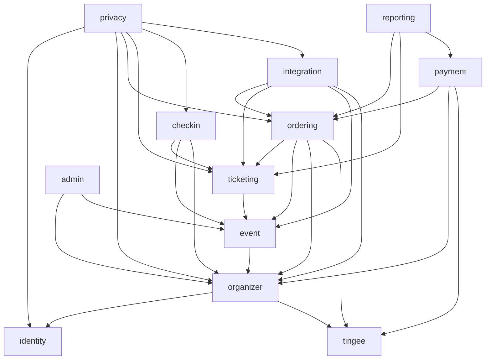

# Review đối kháng — Architecture Spine Tickee MVP v1

**Cách làm:** Với mỗi lỗ hổng, review dựng hai đơn vị ở tầng ngay dưới spine (epic hoặc story) do hai agent AI làm độc lập. Mỗi agent tuân thủ đúng từng chữ của mọi AD, nhưng hai bản build ra vẫn không khớp nhau, hoặc khớp nhau nhưng cùng để lọt một lỗi nghiệp vụ. Mỗi mục có kịch bản cụ thể, mức độ, và Rule đề xuất (AD mới hoặc AD siết lại) để đóng lỗ hổng. Review không sửa spine.

Một số mục trùng với `reconcile-prd.md` và `review-rubric.md` (sơ đồ phụ thuộc, AD-1 "held→sold", hủy Sự kiện, Tạm ngừng bán, máy trạng thái Sự kiện). Ở đây các mục đó được viết lại thành kịch bản cặp đơn vị, kèm Rule cụ thể.

## 1. Kết luận

**Chưa dùng được làm build substrate cho nhiều agent làm song song.** Bất biến trên từng thực thể đã chắc: CAS trên Đơn, UPDATE có điều kiện cho tồn kho, IPN idempotent, check-in một lần, không gọi dịch vụ ngoài trong transaction. Agent không thể làm sai các chỗ này nếu làm đúng chữ. Lỗ hổng nằm ở **chỗ nối giữa các mô-đun** và ở **các vòng đời spine không quản**:

1. **Sơ đồ phụ thuộc mâu thuẫn với chính các AD**, còn AD-12 lại cho enqueue job tới bất kỳ queue nào. Gặp chỗ sơ đồ cấm gọi, mỗi agent sẽ lách một kiểu, và CI kiểm import vẫn xanh cho mọi kiểu.
2. **Chỉ Đơn có máy trạng thái.** Sự kiện, Vé, mục Cần xử lý, lời mời CTV, kết nối Sheets, Merchant con và "Tạm ngừng bán" đều không có. Hủy và khóa Sự kiện (FR-33, FR-35) rơi vào khe giữa các mô-đun.
3. **Hiệu ứng tồn kho của từng chuyển trạng thái chưa được ghi ra.** AD-1 viết chung "chuyển `held`→`sold`", nhưng câu này sai với 3 trong 4 nguồn phát Vé.
4. **Tiền điều kiện nằm ngoài câu CAS.** AD-3 chỉ chốt `WHERE status=:from`. Các điều kiện "còn chỗ", "chưa có link", "capacity ≥ sold+held" vì vậy dễ bị kiểm bằng một SELECT trước, thành lỗi TOCTOU (kiểm rồi mới ghi, dữ liệu đổi ở giữa).
5. **Hàm ghi không mang phạm vi BTC.** CAS ở AD-1 và AD-3 chỉ lọc theo `id`, còn AD-13 chỉ nói tới "truy vấn".

| Mức | Số mục |
| --- | --- |
| Critical | 4 |
| High | 11 |
| Medium | 8 |

**Điểm không tấn công được, nên giữ:** chống phát Vé trùng hai lớp (khóa unique `payment_events` cộng CAS), giữ chỗ bằng một câu UPDATE có điều kiện, TX1 → gọi Tingee → TX2, chữ ký IPN tính trên raw body, check-in bằng một UPDATE, realtime chỉ là tín hiệu.

## 2. Bảng tóm tắt

| # | Lỗ hổng | Mức | AD bị lách | Đóng bằng |
| --- | --- | --- | --- | --- |
| A-01 | Hủy Sự kiện không có chủ điều phối; Đơn đang mở vẫn phát Vé sau khi hủy | Critical | AD-3, AD-10, AD-12, AD-21 | AD-26 mới, siết AD-3 |
| A-02 | Sơ đồ phụ thuộc mâu thuẫn với AD-2, AD-24, FR-33, FR-35; AD-12 là cửa sau; hai nguồn số suất | Critical | AD-2, AD-10, AD-12, AD-24 | Siết AD-10, AD-12, sơ đồ mới |
| A-03 | `markPaid` "chuyển held→sold" cho mọi nguồn → `held` âm, bán quá | Critical | AD-1, AD-2, AD-3 | Siết AD-1, AD-25 mới |
| A-04 | CAS không mang `organization_id` → ghép tay hoặc đánh dấu chéo BTC | Critical | AD-1, AD-3, AD-13 | Siết AD-13, AD-3 |
| A-05 | Đơn Cần xử lý giữ chỗ hay nhả chỗ: ba cách đọc, không có hạn | High | AD-1, AD-2, AD-3 | AD-25 |
| A-06 | Mục Cần xử lý và Đơn có hai vòng đời; lệch tiền trên Đơn `expired`/`paid` bị kẹt | High | AD-3, AD-7 | AD-29 mới |
| A-07 | Giảm số suất đua với giữ chỗ; trần 200 trải trên nhiều dòng | High | AD-2 | Siết AD-2 |
| A-08 | Job hết hạn (`ordering`) không đọc được xác nhận của `payment`, nên tự gọi Tingee và bỏ qua kiểm số tiền | High | AD-4, AD-8, AD-10 | AD-30 mới |
| A-09 | Tiền điều kiện của AD-4 nằm ngoài CAS: hết hạn đua với TX2 gắn link | High | AD-3, AD-4 | Siết AD-3 |
| A-10 | Sự kiện không có máy trạng thái; khóa vừa là trạng thái vừa là cờ; vô hiệu Vé không đảo ngược được | High | AD-14, AD-21 | AD-27 mới |
| A-11 | Trạng thái Vé: `checked_in` là cột hay trạng thái; check-in không xét hủy, khóa, `effective_end_at` | High | AD-14, AD-15 | AD-28 mới |
| A-12 | Cờ "Tạm ngừng bán" không có chủ, không có đường gỡ | High | AD-6, AD-8, AD-21 | AD-31 mới |
| A-13 | Link mời CTV là bearer token; thu hồi link có thu hồi CTV đã nhận hay không chưa rõ | High | AD-13, AD-14 | AD-32 mới |
| A-14 | Xóa tài khoản đua với Đơn đang mở, vai Owner và IPN muộn | High | AD-10, AD-24 | AD-33 mới |
| A-15 | Kết nối Sheets nằm trong Google của thành viên đã rời BTC → dữ liệu vẫn chảy ra ngoài | High | AD-19, AD-23 | AD-34 mới |
| A-16 | Sheets: "Đơn đã đổi" không định nghĩa; con trỏ `updated_at` làm mất thay đổi; check-in không kích hoạt đồng bộ; throttle bỏ job | Medium | AD-12, AD-23 | Siết AD-23, AD-12 |
| A-17 | Sửa Sự kiện sau khi đã phát Vé: tính lại `effective_end_at` xóa mất "Kết thúc sớm"; khóa idempotent nuốt email | Medium | AD-12, AD-14 | AD-36 mới, siết AD-12 |
| A-18 | Đơn 0đ: lẫn lộn "Sự kiện miễn phí" và "Đơn miễn phí"; trộn Hạng vé 0đ với Hạng vé có phí; đổi giá làm đổi loại Sự kiện | Medium | AD-1, AD-2, AD-3, AD-6 | AD-35 mới |
| A-19 | Số tiền đã trả không nằm trên Đơn; `reporting` không đọc được `payment`; đánh dấu hoàn tay không có audit | Medium | AD-10, AD-18 | AD-29, siết AD-18 |
| A-20 | Check-in cần tên, SĐT, email người mua nhưng `checkin` và `ticketing` không được gọi `ordering` → bản sao PII ngoài phạm vi AD-24 | Medium | AD-10, AD-24 | AD-38 mới |
| A-21 | Đổi tài khoản nhận tiền khi còn Đơn mở; IPN không đối chiếu `merchantId` | Medium | AD-6, AD-8, AD-9 | AD-37 mới |
| A-22 | Link chia sẻ Vé là đường truy cập không có tên trong AD-13 | Medium | AD-13, AD-16 | AD-39 mới |
| A-23 | Sửa form mua vé sau khi đã có Đơn: CSV và Sheets lệch cột | Medium | AD-23 | AD-40 mới |

---

## 3. Chi tiết

### A-01 — Hủy Sự kiện không có chủ điều phối; Đơn đang mở vẫn phát Vé sau khi hủy — **Critical**

**Đơn vị A:** Epic "Quản lý Sự kiện", story "Hủy Sự kiện" (FR-33), viết trong `event`.
**Đơn vị B:** Epic "Thanh toán", story "IPN và Đối soát bù" (FR-19, FR-20), `payment` gọi `ordering.markPaid`.

**A tuân thủ:** Trạng thái Sự kiện thuộc `event`, nên A chạy `UPDATE events SET status='cancelled'` và `audit.record` (AD-18). Sơ đồ không cho `event` gọi `ordering` hay `ticketing`, nên A enqueue `ordering.cancel-event-orders` và `integration.event-cancelled-email` bằng cùng `tx` (AD-12 cho enqueue theo tên queue). Handler bên `ordering` chuyển `paid→cancelled` (cạnh duy nhất trong AD-3 có nhãn "Sự kiện bị hủy") và vô hiệu Vé. Sơ đồ không có cạnh nào cho Đơn `pending`, `review`, `expired`, nên các Đơn này giữ nguyên.

**B tuân thủ:** `markPaid` CAS `status IN (pending, expired)`; với Đơn `expired`, "còn chỗ" là đủ để phát Vé (AD-3). Không AD nào bắt `markPaid` xét trạng thái Sự kiện, vì `sellability` (AD-21) chỉ áp cho trang công khai và lúc tạo Đơn.

**Chỗ vỡ:**
1. Lúc hủy, Đơn X đang Chờ thanh toán, link Gateway còn 12 phút. Người mua trả tiền → IPN → `pending→paid` → phát Vé và gửi email "Vé của bạn" cho một Sự kiện đã hủy. Job hủy đã chạy xong từ trước, nên X ở lại `paid`, Vé vẫn `valid`, và X không có trong danh sách hoàn tiền.
2. Từ lúc A commit tới lúc job chạy xong (pg-boss có độ trễ và retry, job có thể lỗi giữa chừng), mọi IPN đến trong khoảng đó đều phát Vé. Nếu job lỗi giữa chừng, Sự kiện còn một nửa Đơn `paid` và một nửa `cancelled`.
3. Đơn Y đã `expired` nhận tiền về muộn sau khi Sự kiện bị hủy → `expired→paid` vì "còn chỗ" (Sự kiện hủy nên chỗ trống còn nhiều).
4. Đơn Z đang `review`: BTC vẫn bấm duyệt tay → `review→paid` → phát Vé.
5. AD-15 check-in chỉ xét `status='valid'`, nên Vé ở các trường hợp 1, 3, 4 quét ra xanh.

Kết quả: người mua trả tiền cho một Sự kiện đã hủy và không nằm trong danh sách hoàn tiền. SM-1 xếp đây là lỗi nghiêm trọng.

**Đề xuất — AD-26 (mới): Hủy Sự kiện là một thao tác của `ordering`, chạy trong một transaction**

> **Rule:** Điểm vào duy nhất là `ordering.cancelEvent(tx, scope, eventId, actor)`; controller `POST /v1/events/:id/cancel` thuộc `ordering`. Thứ tự khóa cố định cho mọi luồng chạm Đơn của một Sự kiện: dòng `events` (qua `event.lockForOrdering(tx, eventId, mode)`) → `ticket_type_inventory` theo `ticket_type_id` tăng dần → `orders`. Tạo Đơn (TX1) và `markPaid` lấy `FOR SHARE`, `cancelEvent` lấy `FOR UPDATE`. Sau khi có khóa, các luồng này đọc lại trạng thái Sự kiện; nếu `cancelled` thì không giữ chỗ và không phát Vé. Trong cùng một transaction, `cancelEvent` làm đủ các bước: (1) `event.markCancelled(tx, eventId)`, CAS từ `draft|published|hidden`; (2) chuyển mọi Đơn `pending|review|paid` → `cancelled` theo AD-25 (AD-3 thêm cạnh `pending→cancelled` và `review→cancelled`, nhãn "Sự kiện bị hủy"); (3) `ticketing.voidByEvent(tx, eventId, 'event_cancelled')`; (4) enqueue email và Sheets; (5) `audit.record`. Tiền về cho một Đơn của Sự kiện đã hủy thì không phát Vé: `payment` ghi tiền lên Đơn (AD-29) và mở mục Cần xử lý loại `after_cancel`; Đơn vẫn ở `cancelled` và có trong danh sách hoàn tiền. `cancelled` là trạng thái cuối của Sự kiện. Nếu Gateway có API hủy link, `cancelEvent` enqueue job hủy link cho các Đơn vừa chuyển từ `pending`.

Kiểm thử bắt buộc: chạy `cancelEvent` đồng thời với `markPaid` cho cả Đơn `pending` lẫn Đơn `expired`, rồi kiểm không Đơn nào kết thúc ở `paid` với Vé `valid`.

---

### A-02 — Sơ đồ phụ thuộc mâu thuẫn với chính các AD; AD-12 thành cửa sau — **Critical**

Các cạnh mà AD hoặc FR cần nhưng sơ đồ không có:

| Cần cho | Cạnh cần | Trong sơ đồ |
| --- | --- | --- |
| AD-2: "`event` đổi số suất qua `ordering`"; tạo Hạng vé phải tạo dòng `ticket_type_inventory` | `event → ordering` | Không có; thêm vào thì thành vòng với `ordering → event` |
| AD-24: `identity.deleteAccount()` điều phối mọi mô-đun | `identity → *` | Không có; `identity` nằm ở đáy |
| FR-33 hủy Sự kiện | `event → ordering`, `event → ticketing` | Không có |
| FR-35 vô hiệu Vé khi khóa | `admin → ticketing` | Không có |
| FR-27, FR-29: tên người mua, tra theo SĐT/email | `checkin → ordering` | Không có |
| FR-33 "số tiền đã trả", FR-21 đếm số mục Cần xử lý | `reporting → payment` | Không có |
| AD-4(b): job hết hạn cần xác nhận "chưa trả" từ `payment_events` | `ordering → payment` | Không có; thêm vào thì thành vòng |

**Đơn vị A:** Epic "Sự kiện và Hạng vé", trong `event`. **Đơn vị B:** Epic "Checkout và tồn kho", trong `ordering`.

**A tuân thủ:** A không import `ordering` (AD-10). A lưu `ticket_types.capacity` vào bảng của chính `event`, vì form sửa Hạng vé cần chỗ lưu số suất, rồi enqueue `ordering.sync-capacity` (AD-12: "enqueue theo tên queue, không import mô-đun xử lý"). CI kiểm import vẫn xanh.
**B tuân thủ:** `ticket_type_inventory` là nguồn số suất duy nhất (AD-2). B mở endpoint `PATCH /v1/ticket-types/:id/capacity` ngay trong `ordering`, vì `ordering → event` là cạnh hợp lệ.

**Chỗ vỡ:** Hệ thống có hai endpoint đổi số suất và hai cột số suất. BTC sửa trên form của A: `ticket_types.capacity` đổi, còn job đồng bộ chạy sau, có thể lỗi, và không kiểm `≥ sold+held` trong cùng câu lệnh. Trang công khai đọc `sellability` theo `inventory`, trong khi dashboard của A hiện `ticket_types.capacity`. Tạo Hạng vé mới: `event` chèn dòng nhưng chưa có `inventory`, nên `sellability` của B trả "Hết vé" hoặc lỗi cho tới khi job chạy. Cùng kiểu lách này lặp lại ở hủy Sự kiện (A-01), xóa tài khoản (A-14) và khóa Sự kiện (A-10). Mỗi agent chọn một cách riêng: job ngược chiều, đổi điểm vào, hoặc nhân bản dữ liệu.

**Đề xuất — siết AD-10 và AD-12, kèm sơ đồ mới (mục 4)**

> **Rule (AD-10, thêm):** Một thao tác cần ghi vào nhiều mô-đun đặt điểm vào API ở mô-đun **cao nhất** trong sơ đồ có liên quan, rồi gọi xuống các mô-đun dưới trong cùng `tx`. Cụ thể: tạo, xóa và đổi số suất Hạng vé, cùng hủy Sự kiện, có điểm vào ở `ordering`; `event` chỉ xuất `insertTicketType(tx, …)`, `markCancelled(tx, …)` để `ordering` gọi. `capacity` chỉ có ở `ticket_type_inventory`; bảng `ticket_types` không có cột số suất. Xóa tài khoản thuộc mô-đun mới `privacy`, nằm trên cùng sơ đồ (AD-33). Sơ đồ thêm các cạnh `reporting → payment`, `integration → organizer`, `payment → organizer`, `privacy → {identity, organizer, ordering, ticketing, checkin, integration}`.
>
> **Rule (AD-12, thêm):** Một mô-đun chỉ enqueue vào queue mà handler thuộc mô-đun nằm **dưới** nó trong sơ đồ, hoặc thuộc chính nó. Cần báo ngược chiều thì dùng domain event khai báo trong `packages/contracts/events.ts`, đặt tên ở thì quá khứ (`organizer.member-removed`, `organizer.payment-service-restored`). Handler của domain event không được là bước bắt buộc để giữ bất biến: bất biến phải còn đúng ngay cả khi job trễ vô hạn. CI kiểm luôn cả lệnh enqueue, không chỉ lệnh import.

---

### A-03 — `markPaid` "chuyển held→sold" cho mọi nguồn → `held` âm, bán quá số suất — **Critical**

**Đơn vị A:** Story "Phát Vé từ IPN": `ordering.markPaid` viết đúng chữ AD-1, tức CAS `status IN ('pending','expired','review')` rồi `held -= n, sold += n`.
**Đơn vị B:** Story "Đơn miễn phí" và story "Duyệt tay", dùng lại `markPaid` với `source='free'` và `source='manual'` (AD-1 liệt kê đủ bốn nguồn).
**Đơn vị C:** Story "Hết hạn": `pending→expired` và `held -= n` trong cùng transaction (AD-2).

**Chỗ vỡ:** Hạng vé có capacity 10, đã bán 9. Đơn X (1 Vé) chờ thanh toán: held = 1. Job hết hạn chuyển X sang `expired`: held = 0. Người mua Y giữ chỗ: held = 1, tổng 9 + 1 = 10. Tiền của X về muộn: AD-3 cho `expired→paid`, và AD-1 nói "chuyển held→sold", nên held = 0, sold = 10. Y trả tiền: held = −1, sold = 11. **Bán quá số suất.** Nếu có ràng buộc `CHECK (held >= 0)`, giao dịch của Y bị rollback: Y đã trả tiền mà không nhận Vé, IPN lỗi lặp lại cho tới khi Tingee hết 5 lần thử.

Với Đơn miễn phí, Đơn không có `held`, nên `held -= n` cho số âm ngay từ Đơn đầu tiên.

Biến thể TOCTOU: agent SELECT `status` trước để chọn hiệu ứng tồn kho, rồi CAS với `IN (...)`. Job hết hạn commit chen vào giữa hai bước, và kết quả giống hệt. `UPDATE … RETURNING` trả về giá trị **mới**, nên một CAS nhiều nguồn không biết nó vừa thay trạng thái nào, trừ khi dùng `RETURNING OLD.status` (có từ PG 18).

**Đề xuất — siết AD-1 và thêm AD-25 (mới): Hiệu ứng tồn kho theo từng chuyển trạng thái**

> **Rule (AD-1, thay cụm "chuyển `held`→`sold`"):** Mỗi lần gọi `markPaid(tx, scope, orderId, source, paymentRef)` chỉ CAS từ **đúng một** trạng thái nguồn. Muốn nhận nhiều nguồn trong một câu thì bắt buộc dùng `RETURNING OLD.status, OLD.inventory_state` và tính hiệu ứng tồn kho từ giá trị OLD. Cấm SELECT trạng thái trước rồi mới CAS.
>
> **Rule (AD-25):** `orders.inventory_state ∈ {none, held, sold, released}`. Cột này đổi trong chính câu CAS của Đơn, và mỗi chuyển chạy đúng câu tồn kho dưới đây trong cùng transaction:
>
> | Chuyển | `inventory_state` | Câu trên `ticket_type_inventory` |
> | --- | --- | --- |
> | tạo Đơn có phí | none → held | `held += n WHERE sold+held+n <= capacity` |
> | `pending→paid` | held → sold | `held -= n, sold += n` |
> | `pending→expired`, `pending→cancelled`, `pending→review` | held → released | `held -= n` |
> | `expired→paid`, `review→paid` (nếu đang `released`), tạo Đơn 0đ | released/none → sold | `sold += n WHERE sold+held+n <= capacity` |
> | `paid→cancelled` (Sự kiện hủy) | sold → released | `sold -= n` |
> | còn lại | không đổi | — |
>
> Mọi câu tồn kho trả về 0 dòng thì rollback cả transaction. Job đối chiếu so `held` với tổng số lượng của các Đơn `inventory_state='held'`, và `sold` với tổng của các Đơn `sold` (bằng số Vé `valid`). DB có `CHECK (held >= 0 AND sold >= 0 AND sold + held <= capacity)` làm chốt chặn cuối.

---

### A-04 — CAS không mang `organization_id` → ghép tay hoặc đánh dấu chéo BTC — **Critical**

**Đơn vị A:** Story "Xử lý hàng Cần xử lý: ghép tay giao dịch chưa khớp với Đơn" (FR-21), trong `payment`.
**Đơn vị B:** Story "Hàm chuyển trạng thái Đơn", trong `ordering`.

**A tuân thủ:** A nạp mục Cần xử lý qua `orgScope(ctx)` (AD-13). BTC tìm Đơn đích theo mã Đơn, vì AD-20 nói mã Đơn là "mã duy nhất hiển thị cho … BTC". A nhận mã từ body, đổi ra `orderId`, rồi gọi `ordering.markPaid(tx, orderId, 'manual')`.
**B tuân thủ:** SQL đúng nguyên văn AD-1 và AD-3: `WHERE id=:id AND status IN (...)`. Hàm này còn được worker gọi trong `systemScope`, nên B không phụ thuộc vào `ctx`.

**Chỗ vỡ:** A cho rằng B kiểm BTC, còn B cho rằng người gọi đã kiểm. Mã Đơn hiện cho người mua và hay nằm trong ảnh chụp màn hình. Một thành viên BTC P có trong tay mã một Đơn đang chờ hoặc đã hết hạn của Sự kiện thuộc BTC Q. Người này ghép một giao dịch 2.000đ chưa khớp của P vào Đơn đó: hệ thống phát Vé cho Sự kiện của Q, trong khi Q không nhận được đồng nào. Cùng lỗ đó: `cancelled→refunded` trên Đơn của BTC khác làm Đơn biến mất khỏi danh sách hoàn tiền của họ. Bộ test cách ly của AD-13 chỉ kiểm "đọc được dữ liệu BTC khác", nên các lệnh ghi theo id lọt qua.

Thêm nữa, AD-3 không có cạnh nào cho việc "ghép tay vào Đơn đang chờ" (FR-21). Agent sẽ tự chế `pending→paid` với nguồn `manual`, hoặc `pending→review→paid` gói trong một transaction.

**Đề xuất — siết AD-13 và AD-3**

> **Rule:** Mọi service ghi xuất từ `index.ts` nhận `scope` làm tham số bắt buộc (`orgScope | buyerScope | systemScope | platformAdminScope`). Với `orgScope`, câu UPDATE có thêm `AND organization_id = :scopeOrg`; 0 dòng thì trả `NOT_FOUND`, không trả `CONFLICT`. Ghép tay chỉ chọn được Đơn tìm thấy trong `orgScope`, cùng `organization_id` và cùng `merchant_id` (AD-37) với khoản tiền của mục Cần xử lý. Đơn đích phải đang ở `pending` hoặc `expired`. Luồng ghép tay đi qua `review` trong cùng transaction (gắn mục vào Đơn, chuyển Đơn sang `review`, rồi duyệt), để thao tác tay chỉ có một đường vào `paid`. Bộ test cách ly có thêm test ghi chéo cho **mọi** endpoint ghi: gọi bằng id của BTC khác và kỳ vọng 404, dữ liệu không đổi.

---

### A-05 — Đơn Cần xử lý giữ chỗ hay nhả chỗ: ba cách đọc, không có hạn — **High**

**Đơn vị A:** Story "IPN lệch số tiền" (`payment` → `ordering`, `pending→review`).
**Đơn vị B:** Story "Job đối chiếu tồn kho" (AD-2).
**Đơn vị C:** Story "Duyệt tay" (`review→paid`).

**Mỗi bên tuân thủ một câu khác nhau:**
- A đọc AD-1 ("markPaid … chuyển held→sold" cho cả nguồn duyệt tay), suy ra `review` vẫn giữ `held`, nên `pending→review` không động tới tồn kho.
- B đọc AD-2 ("so `held` với số Vé của Đơn **Chờ thanh toán**"), suy ra Đơn `review` không giữ chỗ.
- C đọc AD-3 ("`review→paid`: duyệt tay, **còn chỗ**"), suy ra phải giành chỗ lại.

**Chỗ vỡ:** Theo A, chỗ của Đơn `review` bị giữ **mãi**, vì job hết hạn chỉ quét `pending` và hàng Cần xử lý không có hạn. Một Sự kiện có 5 Đơn lệch tiền mà BTC không xử lý sẽ hiện "Hết vé" trong khi còn 5 chỗ. Job đối chiếu của B báo lệch mỗi lần chạy, cảnh báo thành nhiễu, và tới lúc có lệch thật thì không ai để ý. C, viết theo cách "giành chỗ lại", gặp tồn kho theo kiểu A thì đếm chỗ hai lần và từ chối duyệt dù chỗ đang được giữ. C viết theo kiểu A gặp Đơn mồ côi (không có `held`) thì làm `held` âm (A-03).

**Đề xuất:** AD-25 chốt `pending→review` là `held → released` (nhả chỗ ngay), và `review→paid` phải giành `sold` mới với điều kiện còn chỗ. Cách này khớp với chữ của AD-2 và nhãn của AD-3. Đổi lại, duyệt tay có thể thất bại khi Sự kiện đã bán hết, và BTC phải hoàn tiền; đây là đánh đổi đã chấp nhận ở FR-14. Nếu sản phẩm muốn giữ chỗ trong lúc chờ duyệt, Rule phải có hạn rõ ràng, ví dụ `review_hold_expires_at = now() + 24h`, và job nhả chỗ bằng CAS trên dòng Đơn (`inventory_state` từ `held` sang `released`).

---

### A-06 — Mục Cần xử lý và Đơn có hai vòng đời; lệch tiền trên Đơn `expired` hoặc `paid` bị kẹt — **High**

**Đơn vị A:** Story "IPN và Cần xử lý" trong `payment`: sở hữu `review_items`, mở mục khi lệch số tiền.
**Đơn vị B:** Story "Máy trạng thái Đơn" trong `ordering`: sở hữu `orders.status` và chỉ cho các cạnh có trong AD-3.

**Kịch bản 1 — lệch tiền trên Đơn đã hết hạn:** Đơn X đã `expired`, rồi tiền về muộn nhưng thiếu: `paidAmount` 290k so với tổng 300k. AD-7 bảo đưa vào Cần xử lý "Lệch số tiền". A thử `pending→review` và nhận 0 dòng ("đọc lại và xử lý theo nó"). Trạng thái hiện tại là `expired`, mà cạnh `expired→review` trong AD-3 chỉ có nhãn "hết chỗ". A vẫn mở mục Cần xử lý, còn Đơn ở `expired`. BTC bấm Duyệt: `review→paid` thất bại vì Đơn không ở `review`. BTC bấm Từ chối: `review→cancelled` cũng thất bại. Tiền đã về mà mục này không xử lý được.

**Kịch bản 2 — hai khoản tiền cho một Đơn:** IPN thứ nhất 290k làm Đơn sang `review` và mở mục R1. Người mua trả thêm 10k (link còn hạn, Gateway ở trạng thái partially-paid): IPN thứ hai có `providerTransactionCode` khác, lại lệch tiền, A mở thêm mục R2. BTC duyệt R1: Đơn sang `paid`. R2 vẫn mở. BTC từ chối R2: `review→cancelled` thất bại vì Đơn đã `paid`, hoặc A đánh dấu R2 là `rejected` mà không ghi khoản 10k ở đâu cả. Đối soát bù (AD-8) chỉ quét Đơn `pending`, nên nếu IPN thứ hai bị mất thì không ai thấy khoản 10k.

**Kịch bản 3 — hoàn tiền:** `refunded` chỉ đi được từ `cancelled`. Khoản tiền thừa trên một Đơn `paid` không có chỗ để đánh dấu đã hoàn.

**Đề xuất — AD-29 (mới): Vòng đời mục Cần xử lý và tiền theo Đơn**

> **Rule:** `review_items` thuộc `payment`, có máy trạng thái riêng: `open → approved | rejected`, và `rejected → refund_marked`. Loại mục: `amount_mismatch`, `orphan`, `after_cancel`, `unmatched`, `overpaid`, `wrong_merchant`. Mỗi Đơn có tối đa một mục `open` (unique partial index `(order_id) WHERE status='open'`); khoản tiền đến sau được cộng vào mục đang mở. Mỗi khoản tiền hợp lệ gọi `ordering.recordPayment(tx, scope, orderId, amount, paymentEventId)` để cộng vào `orders.paid_amount`, trong cùng transaction với `payment_events`. Quyết định phát Vé dựa trên `paid_amount` **lũy kế** so với tổng Đơn. Mọi lần chuyển Đơn sang `review` đều do `payment` thực hiện, và mục Cần xử lý được tạo trong cùng transaction đó. AD-3 đổi nhãn `expired→review` thành "không phát được Vé (lệch tiền, hết chỗ, Sự kiện đã hủy)". Duyệt: đặt mục thành `approved` rồi gọi `markPaid(source=manual)` từ trạng thái hiện tại của Đơn; nếu 0 dòng thì mục vẫn `open` và trả lỗi rõ ràng. Từ chối: đặt mục thành `rejected`, và chỉ chuyển `review→cancelled` khi Đơn đang ở `review`. Đánh dấu hoàn tay làm trên mục (`refund_marked`, kèm số tiền, người làm, audit); với Đơn đang `cancelled` thì chuyển thêm `cancelled→refunded`. Đối soát bù (AD-8) quét cả Đơn `review` khi link còn hạn.

---

### A-07 — Giảm số suất đua với giữ chỗ; trần 200 trải trên nhiều dòng — **High**

**Đơn vị A:** Story "Sửa số suất Hạng vé". **Đơn vị B:** Story "Giữ chỗ khi tạo Đơn".

**A tuân thủ:** AD-2 chỉ nói "capacity mới ≥ `sold + held`" mà không nói phải kiểm thế nào. A viết theo kiểu Drizzle quen tay: `select` dòng tồn kho, so sánh trong code, rồi `update … set capacity`.
**B tuân thủ:** Câu giữ chỗ đúng nguyên văn AD-2.

**Chỗ vỡ:** capacity 100, sold 60, held 30. BTC giảm xuống 90: A đọc 60 + 30 = 90 ≤ 90 nên cho qua. Ngay lúc đó B giữ thêm 5: held = 35 (95 ≤ 100, hợp lệ). A ghi capacity = 90. Lúc này sold + held = 95 > 90. Nếu cả 35 Đơn đều trả tiền thì sold = 95, vượt số suất BTC vừa đặt. Đây đúng là lỗi "bán quá số suất" mà SM-1 cấm.

Trần 200 của Sự kiện miễn phí là ràng buộc trên **tổng** nhiều dòng tồn kho, nên một câu UPDATE có điều kiện trên một dòng không giữ được. Ví dụ hai Hạng vé có số suất 100 và 50. Hai tab cùng lúc nâng Hạng vé thứ nhất lên 140 (tổng thấy được là 190) và Hạng vé thứ hai lên 100 (tổng thấy được là 200). Cả hai đều qua kiểm tra, và tổng cuối cùng là 240.

**Đề xuất — siết AD-2**

> **Rule:** Đổi số suất là đúng một câu `UPDATE ticket_type_inventory SET capacity = :new WHERE ticket_type_id = :id AND sold + held <= :new RETURNING …`. Nếu 0 dòng thì trả `CAPACITY_BELOW_COMMITTED`, kèm giá trị `sold + held` hiện tại. Mọi thao tác làm đổi tổng số suất của một Sự kiện (đổi capacity, thêm hoặc xóa Hạng vé) phải khóa trước **mọi** dòng tồn kho của Sự kiện đó, theo `ticket_type_id` tăng dần (`FOR UPDATE`), rồi mới kiểm trần trên tổng. Xóa Hạng vé chỉ được khi `sold + held = 0`; nếu không thì chỉ được đóng bán.

---

### A-08 — Job hết hạn không đọc được xác nhận của `payment`, nên tự gọi Tingee và bỏ qua kiểm số tiền — **High**

**Đơn vị A:** Story "Hết hạn Giữ chỗ" trong `ordering` (bảng Capability ghi "Checkout, Giữ chỗ, hết hạn → `ordering`").
**Đơn vị B:** Story "Đối soát bù" trong `payment` (AD-8).

**A tuân thủ:** AD-4(b) đòi "Tingee đã xác nhận chưa trả (IPN `expired`/`canceled` hoặc tra trạng thái)". IPN nằm trong `payment_events`, mà `ordering` không được đọc `payment` (không có cạnh). Có cạnh `ordering → tingee`, nên A tự gọi `tingee.getGatewayOrderStatus(orderId)`. Nếu Tingee trả "đã trả", A chuyển Đơn bằng `markPaid(source='reconciliation')`, vì "Đối soát bù" là một trong bốn nguồn hợp lệ của AD-1.
**B tuân thủ:** B quét Đơn `pending` "lặp lại theo backoff **đến hạn**", tức dừng ở `expires_at`, và đi qua hàm xử lý IPN.

**Chỗ vỡ:**
1. Hai cách hiểu cho cùng một giao dịch, đúng điều AD-8 muốn chặn. Nhánh của A không ghi `payment_events`, không kiểm `paidAmount`, không mở mục Cần xử lý khi lệch tiền. Một Đơn trả thiếu 10k mà được A bắt gặp trước sẽ được phát Vé.
2. Sau `expires_at`, B đã dừng. Nếu A không gọi được Tingee (Tingee lỗi, hoặc BTC bị ngắt dịch vụ theo R-3), không bên nào xác nhận được, và Đơn `pending` giữ chỗ vô thời hạn: Sự kiện hiện "Hết vé" suốt thời gian BTC bị ngắt.

**Đề xuất — AD-30 (mới): Hết hạn là một nhánh của Đối soát bù**

> **Rule:** Job hết hạn thuộc `payment` và chạy cùng vòng Đối soát bù. Với mỗi Đơn `pending` đã quá `expires_at`: nếu chưa có link thì gọi `ordering.expire(tx, scope, orderId, reason='no_link')`. Nếu có link thì tra Gateway qua `tingee`, và kết quả **luôn** đi qua hàm xử lý IPN (AD-7, AD-8): đã trả thì `markPaid` hoặc vào Cần xử lý; chưa trả hoặc đã hết hạn thì `ordering.expire`. `ordering` không gọi Tingee để quyết định trạng thái thanh toán. Nếu vẫn không xác nhận được khi đã quá `expires_at + 30 phút` (link Gateway hết hạn thì không trả được nữa), Đơn vẫn chuyển sang Hết hạn với `reason='unconfirmed'` và có cảnh báo; tiền về sau đó đi nhánh tiền về muộn. AD-4(b) được viết lại theo Rule này.

---

### A-09 — Tiền điều kiện của AD-4 nằm ngoài CAS: hết hạn đua với TX2 gắn link — **High**

**Đơn vị A:** Story "Hết hạn loại (a)": SELECT các Đơn `pending AND payment_link IS NULL AND expires_at < now()`, rồi với mỗi Đơn gọi `transition(id, 'pending', 'expired')`, đúng nguyên văn SQL của AD-3.
**Đơn vị B:** Story "TX2 gắn link": CAS `WHERE id AND status='pending'`.

**Chỗ vỡ:** Tingee trả link ở giây thứ 59. A đã SELECT Đơn này ở giây thứ 58. B commit link với `expires_at` = +15 phút. Sau đó A chạy CAS chỉ theo `status='pending'` và thành công. Đơn thành `expired`, chỗ được nhả, trong khi người mua đang cầm một link còn sống. Người mua trả tiền và đi vào nhánh tiền về muộn; nếu Sự kiện đã bán hết thì thành Thanh toán mồ côi. Đây chính là tình huống AD-4 nói nó ngăn.

**Đề xuất — siết AD-3**

> **Rule:** Mọi tiền điều kiện của một chuyển trạng thái nằm trong mệnh đề `WHERE` của **chính** câu CAS. Ví dụ hết hạn loại (a): `AND payment_link_id IS NULL AND expires_at < now()`. TX2 gắn link: `AND status = 'pending' AND payment_link_id IS NULL`. Giữ chỗ lại: điều kiện tồn kho của AD-25. Cấm kiểm tiền điều kiện bằng SELECT trước rồi CAS chỉ theo `status`. Mỗi hàm chuyển trạng thái khai báo danh sách tiền điều kiện của nó trong `packages/contracts`, và test có trường hợp đua cho từng điều kiện.

---

### A-10 — Sự kiện không có máy trạng thái; khóa vừa là trạng thái vừa là cờ; vô hiệu Vé không đảo ngược được — **High**

**Đơn vị A:** Epic "Quản trị Tingee: khóa và mở khóa" (FR-35) trong `admin`. PRD liệt kê "Bị khóa" là một trạng thái Sự kiện, nên A gọi `event.setStatus(tx, 'locked')`. Khi Quản trị Tingee chọn "vô hiệu Vé", A không gọi được `ticketing` (không có cạnh `admin → ticketing`), nên enqueue `ticketing.void-event-tickets`, và Vé chuyển sang `cancelled`, một trạng thái cuối theo PRD.
**Đơn vị B:** Epic "Vòng đời Sự kiện" trong `event`. Bảng Design Paradigm tách "trạng thái Sự kiện" và "khóa Sự kiện", nên B làm khóa thành cột `locked_at`, còn trạng thái thuộc `{draft, published, hidden, ended, cancelled}`. Job tự kết thúc chỉ chuyển `published→ended`.

**Chỗ vỡ:**
1. Mở khóa theo A: `locked → published`. Sự kiện trước đó đang `hidden` bị mở bán lại. Sự kiện đã quá `effective_end_at` hiện "đang mở bán". Job của B không bao giờ kết thúc một Sự kiện đang `locked`.
2. BTC hủy một Sự kiện đang bị khóa (FR-33 không cấm). Sau đó Quản trị Tingee mở khóa và đặt `published`: **Sự kiện đã hủy sống lại**.
3. Khóa nhầm và vô hiệu Vé, rồi mở khóa: Vé `cancelled` không quay về `valid` được, nên người đã trả tiền không vào được cổng.
4. Nếu A dùng cờ thay cho trạng thái Vé, thì `ticketing.checkIn()` theo AD-15 không đọc cờ nào cả, và Vé vẫn quét ra xanh.

**Đề xuất — AD-27 (mới): Máy trạng thái Sự kiện; khóa là trục riêng**

> **Rule:** Chỉ `event` ghi `events.status ∈ {draft, published, hidden, ended, cancelled}`, bằng CAS theo các cạnh: `draft→published`; `published↔hidden`; `{draft, published, hidden}→cancelled` (chỉ qua AD-26); `{published, hidden}→ended` (do job hoặc "Kết thúc sớm"). `ended` và `cancelled` là trạng thái cuối. Khóa nằm trên các cột riêng `locked_at`, `locked_by`, `lock_reason`, `checkin_suspended_at` (do `admin` gọi qua `event`), và mở khóa không động vào `status`. Trong lúc khóa: `sellability` trả "Bị khóa"; BTC không sửa Sự kiện được nhưng vẫn hủy được (để kích hoạt hoàn tiền). "Vô hiệu Vé" khi khóa là đặt `checkin_suspended_at`, tức tạm dừng và đảo ngược được; nó không đổi `tickets.status`. Khóa BTC áp cùng các quy tắc cho mọi Sự kiện của BTC đó thông qua `sellability` và cổng check-in (AD-28).

---

### A-11 — Trạng thái Vé: `checked_in` là cột hay trạng thái; check-in không xét hủy, khóa, `effective_end_at` — **High**

**Đơn vị A:** Story "Check-in" trong `ticketing`. A viết đúng SQL của AD-15: `status='valid' AND checked_in_at IS NULL`, và sau check-in `status` vẫn là `valid`.
**Đơn vị B:** Story "Dashboard check-in và Sheets" (`reporting`, `integration`). PRD ghi "Trạng thái Vé: Hợp lệ → Đã check-in", nên B đếm số đã vào bằng `status='checked_in'` và lọc Vé hợp lệ bằng `status='valid'`.

**Chỗ vỡ:**
1. Dashboard của B hiện 0 người đã vào, và đếm Vé đã check-in thành Vé hợp lệ. Sheets ghi cột "Đã check-in" sai.
2. AD-14 bắt hiệu lực Mã QR vé so với `effective_end_at`, nhưng SQL của AD-15 không có điều kiện đó. Agent `checkin` chỉ kiểm thời hạn **quyền của CTV**, nên Owner hoặc Admin quét sau khi Sự kiện kết thúc vẫn ra xanh.
3. Không có điều kiện nào về hủy hay khóa (A-01, A-10).
4. Không AD nào nói ai được đặt `tickets.status='cancelled'`, đặt qua hàm nào, với lý do gì. Một Vé đã check-in rồi bị hủy theo Sự kiện thì còn đếm vào số "đã vào" hay không, cũng chưa rõ.

**Đề xuất — AD-28 (mới): Máy trạng thái Vé và cổng check-in**

> **Rule:** `tickets.status ∈ {valid, void}`, kèm `void_reason ∈ {event_cancelled}`. Check-in **không** phải một trạng thái, mà là cột `checked_in_at`/`checked_in_by`. Chỉ `ticketing` ghi bảng này. Vé chỉ thành `void` qua `ticketing.voidByEvent(tx, eventId, reason)`, do `ordering.cancelEvent` gọi. `void` là trạng thái cuối, và `checked_in_at` được giữ nguyên để làm báo cáo. `ticketing.checkIn()` trong cùng transaction: đọc cổng của Sự kiện qua `event.getCheckinGate(tx, eventId)` (`FOR SHARE`, gồm `status`, `locked_at`, `checkin_suspended_at`, `effective_end_at`). Cổng đóng thì trả `TICKET_INVALID`, kèm lý do nội bộ. Cổng mở thì chạy UPDATE của AD-15. Số "đã vào" là `checked_in_at IS NOT NULL`. Số "Vé hợp lệ" là `status='valid'`. `contracts` xuất đúng hai định nghĩa này để mọi mô-đun dùng chung.

---

### A-12 — Cờ "Tạm ngừng bán" không có chủ, không có đường gỡ — **High**

**Đơn vị A:** Story "Tạo link Gateway" trong `ordering`. AD-6 viết "Tạo link thất bại vì Token hoặc BTC bị ngắt dịch vụ → Sự kiện hiện Tạm ngừng bán". Bảng `organizations` thuộc `organizer`, nên A ghi cờ vào một bảng của chính mình là `org_sales_state.suspended_at`, và `sellability` đọc cờ này (AD-21: "cờ Tạm ngừng bán từ Tingee").
**Đơn vị B:** Story "Token" (FR-34) trong `organizer`. B định kỳ đọc trạng thái dịch vụ và Token từ Tingee rồi ghi `sub_merchants.service_status`. Khi trạng thái chuyển về active, B enqueue `payment.reconcile-org` (AD-8: "khi BTC được mở lại dịch vụ").

**Chỗ vỡ:** Chỉ cần một lần timeout của Tingee là A bật cờ. Khi cờ đã bật, `sellability` chặn tạo Đơn, nên không còn lần tạo link nào để A thấy dịch vụ đã hồi phục: cờ **không bao giờ tắt**. B thấy dịch vụ active, nhưng `sellability` không đọc dữ liệu của B. Kết quả là Sự kiện kẹt ở "Tạm ngừng bán" cho tới khi có người sửa tay trong DB. Theo hướng ngược lại, nếu A gỡ cờ theo thời gian, cờ sẽ bật tắt liên tục. Ngoài ra không có AD nào định nghĩa "BTC được mở lại dịch vụ" được phát hiện bằng cách nào.

**Đề xuất — AD-31 (mới): Trạng thái dịch vụ thanh toán của BTC**

> **Rule:** `organizer` sở hữu `payment_service_state(organization_id, state ∈ {active, suspended}, reason, since, last_probe_at)`. Trạng thái chuyển sang `suspended` khi: (a) `ordering` gọi `organizer.reportPaymentServiceFailure(tx, orgId, code)` với **mã lỗi Tingee thuộc danh sách** "hết Token" hoặc "ngắt dịch vụ" (timeout và lỗi mạng không tính); hoặc (b) job dò của `organizer` thấy Tingee báo bị ngắt. Trong lúc `suspended`, job dò gọi Tingee mỗi 5 phút. Chuyển `suspended→active` phát domain event `organizer.payment-service-restored`; `payment` nghe event này và Đối soát bù mọi Đơn `pending`, `expired` và `review` của BTC tạo trong khoảng bị ngắt. `sellability` chỉ đọc trạng thái này. Closed Beta bị thu hồi là một nguồn riêng, cũng do `organizer` sở hữu.

---

### A-13 — Link mời CTV là bearer token; thu hồi link có thu hồi CTV đã nhận hay không chưa rõ — **High**

UX đã chốt một link mời dùng chung cho cả Sự kiện. Link được gửi "qua bất kỳ kênh nào" (FR-26), kể cả nhóm Zalo.

**Đơn vị A:** Story "Mời và thu hồi CTV" trong `checkin`: bảng `checker_invites(token, event_id, expires_at, revoked_at)`; nhận lời mời thì chèn `checkers(user_id, event_id)`. A hiểu nút "Thu hồi link" là thu hồi luôn mọi CTV đã vào bằng link đó.
**Đơn vị B:** Story "Màn quét và tra tay" trong `checkin` và `ticketing`. Quyền được kiểm theo từng request (AD-14, AD-19): có dòng `checkers` còn hiệu lực và `now() < effective_end_at`. B không đọc `checker_invites`.

**Chỗ vỡ:**
1. BTC thu hồi link sau khi phát hiện link lọt ra ngoài, nhưng những người đã nhận lời mời **vẫn quét và tra được**. AD-14 và AD-15 không có gì sai, vì không AD nào nói hai bảng này quan hệ với nhau ra sao.
2. Ai có link và có Tài khoản Tickee đều thành CTV, và tra được theo SĐT hoặc email (FR-29). Như vậy họ dò được một SĐT có mua Vé Sự kiện này hay không, xem được tên và Hạng vé, và check-in tay cho người khác vào cổng. Không có giới hạn số lần nhận, không cần BTC duyệt, không giới hạn tần suất tra cứu.
3. Nhận lời mời theo kiểu đọc rồi chèn đua với thao tác thu hồi, nên vẫn chèn được sau khi link đã bị thu hồi.
4. Token nằm trên URL, nên rơi vào access log và header Referer. AD-24 chỉ yêu cầu che SĐT và email trong log.

**Đề xuất — AD-32 (mới): Lời mời và quyền CTV**

> **Rule:** `checker_invites(id, event_id, token_hash, expires_at ≤ effective_end_at, max_uses, use_count, revoked_at)`. Token có 128 bit ngẫu nhiên, DB chỉ lưu bản băm, và token không được ghi vào log (thêm vào danh sách che của AD-24). Nhận lời mời là một câu `UPDATE checker_invites SET use_count = use_count + 1 WHERE id=:id AND revoked_at IS NULL AND now() < expires_at AND use_count < max_uses`, rồi chèn `checkers(event_id, user_id, invite_id, status, revoked_at)` trong cùng transaction. Thu hồi link chỉ chặn các lượt nhận **mới**. Thu hồi CTV là thao tác riêng trên từng dòng `checkers`, và màn quản lý liệt kê CTV đã nhận kèm email để BTC phát hiện người lạ. Tra tay có giới hạn tần suất theo CTV và có ghi audit. Nếu sản phẩm muốn chặt hơn, CTV mới phải được Owner hoặc Admin duyệt trước khi quét được; câu này cần PM chốt.

---

### A-14 — Xóa tài khoản đua với Đơn đang mở, vai Owner và IPN muộn — **High**

**Đơn vị A:** Story "Xóa Tài khoản Tickee" trong `identity`. AD-24 bảo `identity.deleteAccount()` "điều phối", nhưng `identity` không được gọi mô-đun nào. A ẩn danh hóa `users`, xóa session, rồi enqueue `ordering.anonymize-user`, `ticketing.anonymize-user`, `checkin.anonymize-user`, `integration.anonymize-user` (AD-12). FR-38 chỉ đòi cảnh báo khi còn Vé hợp lệ, nên A cảnh báo rồi vẫn xóa.
**Đơn vị B:** Story "IPN" và "Duyệt tay". `markPaid` không xét người mua.

**Chỗ vỡ:**
1. Người dùng xóa tài khoản trong lúc có Đơn đang `pending` hoặc `review`, hoặc vừa `expired`. Tiền về sau đó: B phát Vé cho một tài khoản không đăng nhập được, và email gửi tới địa chỉ đã ẩn danh. Người mua đã trả tiền mà không có Vé, một lỗi nghiêm trọng theo SM-1.
2. Owner xóa tài khoản: BTC mất Owner, trong khi PRD yêu cầu mỗi BTC có đúng một Owner. Không ai liên kết được tài khoản nhận tiền hay mời thành viên nữa.
3. Sự kiện bị hủy sau khi người mua đã xóa tài khoản: danh sách hoàn tiền (FR-33) không còn SĐT hay email để BTC hoàn tiền.
4. Các job ẩn danh hóa chạy bất đồng bộ, nên trong một khoảng thời gian PII đã xóa ở `identity` nhưng vẫn còn ở `ordering`.

**Đề xuất — AD-33 (mới): Xóa Tài khoản Tickee**

> **Rule:** Điểm vào là `privacy.deleteAccount(userId)`, nằm trên cùng sơ đồ phụ thuộc. Tài khoản **chưa xóa được** khi: đang là Owner của một BTC (phải chuyển quyền hoặc đóng BTC trước), hoặc còn Đơn `pending` hoặc `review`. Khi yêu cầu: đặt `users.deletion_requested_at`, chặn đăng nhập, hủy session. Ẩn danh hóa chạy khi đã qua 24 giờ kể từ lần hết hạn cuối cùng của các Đơn của người này, để hấp thụ tiền về muộn. Việc ẩn danh chạy trong **một** transaction gọi `{organizer, ordering, ticketing, checkin, integration}.anonymizeUser(tx, userId)`. `markPaid` cho Đơn của người đã yêu cầu xóa thì không phát Vé mà mở mục Cần xử lý loại `buyer_deleted`. Danh sách hoàn tiền giữ mã Đơn và số tiền; liên hệ của người mua bị ẩn thì BTC liên hệ qua Tingee hoặc theo giao dịch ngân hàng.

---

### A-15 — Kết nối Sheets nằm trong Google của thành viên đã rời BTC — **High (bảo mật, NĐ 13)**

**Đơn vị A:** Story "Kết nối Google Sheets" (FR-32) trong `integration`. Admin Hùng bấm kết nối bằng Google cá nhân. A lưu refresh token đã mã hóa (AD-23) theo `organization_id`.
**Đơn vị B:** Story "Quản lý thành viên" (FR-2) trong `organizer`. Owner xóa Hùng khỏi BTC. Vai trò được tra theo từng request (AD-19), nên Hùng mất quyền vào dashboard ngay.

**Chỗ vỡ:** Job Sheets chạy trong `systemScope` và không kiểm ai đã kết nối. Mỗi phút, job vẫn ghi tên, SĐT, email và câu trả lời form của mọi người mua mới vào một file **trong Drive của Hùng**. Hùng không còn thuộc BTC nhưng vẫn nhận dữ liệu cá nhân mãi mãi. `organizer` không gọi được `integration` (vì sẽ thành vòng), và AD-23 chỉ xử lý trường hợp "mất quyền" ở phía Google.

**Đề xuất — AD-34 (mới): Kết nối Sheets gắn với người kết nối**

> **Rule:** `sheet_connections(organization_id, event_id, connected_by_user_id, google_account_email, token_ciphertext, status)`. Mỗi lần chạy, job Sheets gọi `organizer.isActiveMember(connected_by_user_id, organization_id, ['owner','admin'])` (thêm cạnh `integration → organizer`). Nếu không còn là thành viên, job đặt `status='revoked_member'`, xóa token, enqueue job thu hồi token phía Google, và dashboard báo BTC kết nối lại. `organizer` phát domain event `organizer.member-removed` để thu hồi nhanh hơn, nhưng việc kiểm lúc chạy job mới là thứ giữ bất biến. Dashboard hiện tài khoản Google đang nhận dữ liệu.

---

### A-16 — Sheets: "Đơn đã đổi" không định nghĩa; con trỏ làm mất thay đổi; throttle bỏ job — **Medium**

**Đơn vị A:** Story "Job Sheets" trong `integration`. A gọi `ordering.listChangedOrders(eventId, since)` theo `orders.updated_at`, rồi đặt con trỏ = `now()`. pg-boss chạy với `singletonKey = eventId` và `singletonSeconds = 60`, đúng chữ "tối đa một lần mỗi phút cho mỗi Sự kiện" (AD-23).
**Đơn vị B:** Story "Check-in" trong `ticketing`. AD-15 chỉ cập nhật `tickets`, và AD-12 không bắt check-in enqueue Sheets.

**Chỗ vỡ:**
1. Transaction `markPaid` bắt đầu lúc 10:00:00.900, nên `updated_at = now()` = 10:00:00.900, giờ bắt đầu transaction. Job đọc lúc 10:00:01.000, chưa thấy dòng này, và đặt con trỏ = 10:00:01. `markPaid` commit lúc 10:00:01.200 với `updated_at` nhỏ hơn con trỏ, nên **không bao giờ được đồng bộ**.
2. Check-in không đổi `orders.updated_at`, và `ticketing` không được ghi `orders`, nên cột check-in trên Sheet không bao giờ cập nhật, trái FR-32.
3. Cơ chế throttle của pg-boss **bỏ** lần enqueue thứ hai trong cửa sổ 60 giây chứ không hoãn lại. Thay đổi đến ở giây thứ 30 sau một lần chạy bị mất cho tới khi có một thay đổi khác.
4. Theo AD-12, khóa idempotent là "loại job + id thực thể". Nếu id là `orderId` thì có một job cho mỗi Đơn, trái với chữ "một lần mỗi phút cho mỗi Sự kiện". Nếu id là `eventId` thì các thay đổi khác nhau của cùng Sự kiện bị gộp và mất.

**Đề xuất — siết AD-23 và AD-12**

> **Rule (AD-23):** Mọi thay đổi làm đổi một cột Sheets (mọi chuyển trạng thái Đơn, `recordPayment`, check-in, `voidByEvent`, ẩn danh hóa) enqueue `integration.sheets-order-changed {eventId, orderId}` bằng `tx` của chính thay đổi đó. Handler ghi vào `sheet_sync_queue(event_id, order_id, seq)`. Job flush cho mỗi Sự kiện dùng `singletonKey = eventId` và `singletonNextSlot = true` (hoãn sang lượt sau, không bỏ). Job đọc trạng thái **hiện tại** của các Đơn có trong hàng đợi, ghi lên Sheet, rồi xóa các dòng có `seq` ≤ `seq` đã đọc. Không dùng con trỏ theo `updated_at`.
>
> **Rule (AD-12, thêm):** Khóa idempotent là id của **thay đổi** (`audit_events.id` hoặc id domain event), trừ các job đồng bộ trạng thái đọc dữ liệu mới nhất lúc chạy. Với các job đó, chỉ dùng debounce (`singletonNextSlot`), cấm dùng throttle kiểu bỏ job.

---

### A-17 — Sửa Sự kiện sau khi đã phát Vé: `effective_end_at` xóa mất "Kết thúc sớm"; khóa idempotent nuốt email — **Medium**

**Đơn vị A:** Story "Kết thúc sớm" trong `event`: đặt `effective_end_at = now()` (AD-14).
**Đơn vị B:** Story "Sửa Sự kiện" trong `event`: "`effective_end_at` … tính lại **mỗi khi sửa giờ**" (AD-14). B enqueue `integration.event-changed-email` với khóa `event-changed:<eventId>` (AD-12: loại job + id thực thể).

**Chỗ vỡ:**
1. BTC bấm "Kết thúc" lúc 22:00, rồi 23:00 sửa giờ kết thúc để sửa lỗi gõ. B tính lại theo công thức và `effective_end_at` nhảy sang 05:00 sáng hôm sau. Sự kiện **sống lại**: Vé quay lại "Vé của tôi", quyền CTV có lại. Cùng lỗi đó xảy ra khi sửa giờ một Sự kiện đã `ended` hoặc `cancelled`.
2. BTC sửa giờ lúc 9:00 và sửa lại lúc 9:02. Job thứ hai trùng khóa với job thứ nhất còn trong hàng đợi, nên bị bỏ. Nếu job thứ nhất render email từ payload chụp lúc 9:00, người mua nhận **giờ sai**.
3. BTC sửa 5 lần thì người mua nhận 5 email, nếu khóa theo `audit_id`.

**Đề xuất — AD-36 (mới): Sửa Sự kiện sau khi phát Vé**

> **Rule:** Lưu riêng `events.ended_manually_at`, và `effective_end_at = coalesce(ended_manually_at, công thức của AD-14)`. Sự kiện đang ở `ended` hoặc `cancelled`, hoặc đã quá `effective_end_at`, thì không sửa được giờ và địa điểm. Mỗi lần sửa giờ hoặc địa điểm, enqueue `integration.event-changed {eventId}` với debounce 10 phút (`singletonNextSlot`). Handler so (giờ, địa điểm) **hiện tại** với bản ghi đã báo gần nhất trong `event_notifications(event_id, last_notified_snapshot)`, chỉ gửi khi có khác biệt, và gửi cho người giữ Vé `valid` tại thời điểm chạy, bỏ qua tài khoản đã yêu cầu xóa.

---

### A-18 — Đơn 0đ: "Sự kiện miễn phí" hay "Đơn miễn phí"; trộn Hạng vé 0đ với Hạng vé có phí — **Medium**

Chữ trong spine không nhất quán: AD-1 có nguồn "Đơn miễn phí"; AD-3 ghi `[*]→paid: Sự kiện miễn phí`; AD-2 nói về "Sự kiện miễn phí" và trần 200; AD-6 và AD-21 nói về "Hạng vé có phí ≥ 2.000đ" và "Closed Beta (Hạng vé > 0đ)". Từ AD-6 và AD-21 suy ra được Hạng vé 0đ có thể nằm trong một Sự kiện có phí.

**Đơn vị A:** Story "Tạo Đơn" trong `ordering`. A rẽ nhánh theo **Sự kiện**: nếu mọi Hạng vé là 0đ thì phát Vé ngay, nếu không thì tạo link.
**Đơn vị B:** Story "Đơn miễn phí". B rẽ nhánh theo **tổng Đơn = 0**.

**Chỗ vỡ:**
1. Trong một Sự kiện trộn, Đơn chỉ gồm Hạng vé 0đ: theo A thì tạo link với `amount = 0`, Gateway từ chối vì dưới 2.000đ, transaction bù chuyển Đơn sang Hết hạn. Người mua không bao giờ lấy được Vé 0đ. Theo B thì phát Vé ngay.
2. Trần 200: A áp khi mọi Hạng vé là 0đ. BTC thêm một Hạng vé 2.000đ thì trần 200 biến mất. Ngược lại, BTC hạ giá mọi Hạng vé về 0 sau khi đã bán 250 Vé thì Sự kiện thành "miễn phí" và vượt trần.
3. Sự kiện miễn phí không cần liên kết tài khoản nhận tiền (FR-5). Thêm một Hạng vé có phí vào thì `sellability` chặn **cả** các Hạng vé 0đ hay chỉ Hạng vé có phí? Chưa rõ.
4. Lạm dụng: không có giới hạn theo tài khoản, nên bot đăng ký bằng email OTP có thể lấy hết 200 Vé.

**Đề xuất — AD-35 (mới): Sự kiện miễn phí là thuộc tính cố định**

> **Rule:** `events.pricing_mode ∈ {free, paid}` được chọn lúc tạo Sự kiện và không đổi được sau Đơn đầu tiên. Sự kiện `free`: mọi Hạng vé giá 0, tổng số suất ≤ 200 (kiểm theo A-07), không cần tài khoản nhận tiền, Đơn đi `[*]→paid` (AD-25: `sold += n` có điều kiện). Sự kiện `paid`: mọi Hạng vé giá ≥ 2.000đ, MVP không có Hạng vé 0đ. Sự kiện `free` giới hạn mỗi tài khoản một Đơn mặc định (BTC chỉnh được), và endpoint tạo Đơn có giới hạn tần suất theo tài khoản. Nếu PM muốn cho trộn Hạng vé, phải viết lại Rule này trước khi chia story.

---

### A-19 — Số tiền đã trả không nằm trên Đơn; `reporting` không đọc được `payment`; đánh dấu hoàn tay không có audit — **Medium**

**Đơn vị A:** Story "Danh sách cần hoàn tiền" (FR-33) trong `reporting`. `reporting` chỉ gọi được `ordering` và `ticketing`, nên "số tiền đã trả" lấy từ `orders.total_amount`.
**Đơn vị B:** Story "IPN" trong `payment`: số tiền thực nhận (`paidAmount`) chỉ nằm trong `payment_events`.

**Chỗ vỡ:** Một Đơn lệch tiền (trả 290k cho tổng 300k) bị hủy theo Sự kiện. Danh sách hoàn tiền ghi 300k: BTC hoàn thừa, hoặc người mua khiếu nại. Một Đơn trả hai lần thì ghi 300k thay cho 600k. Khoản tiền về sau khi hủy (A-01) không xuất hiện. Dashboard đếm số mục Cần xử lý (FR-21) cũng không đọc được `review_items`. AD-18 có liệt kê "xử lý hàng Cần xử lý", nhưng không liệt kê "đánh dấu Đã hoàn tay" cho Đơn đã hủy theo Sự kiện.

**Đề xuất:** AD-29 thêm `orders.paid_amount`, do `ordering.recordPayment` cập nhật trong cùng transaction với `payment_events`. Danh sách hoàn tiền = các Đơn của Sự kiện có `paid_amount > 0` và `status = 'cancelled'`, cộng với các mục Cần xử lý `after_cancel`. Mỗi dòng ghi `paid_amount − refunded_amount`. Thêm cạnh `reporting → payment` (chỉ đọc).

> **Rule (AD-18, thêm vào danh sách bắt buộc):** hủy Sự kiện, vô hiệu hoặc tạm dừng Vé, đánh dấu Đã hoàn tay (kèm số tiền), ghép tay, thu hồi link mời CTV, kết nối và ngắt kết nối Sheets, yêu cầu xóa tài khoản.

---

### A-20 — Check-in cần tên, SĐT, email người mua nhưng không được gọi `ordering` → bản sao PII ngoài phạm vi AD-24 — **Medium**

**Đơn vị A:** Story "Phát Vé" trong `ticketing`, được gọi từ `markPaid`. Màn quét phải hiện "Minh · Vé 2/2 · Đôi nam" (FR-27), và tra tay theo SĐT hoặc email (FR-29). `checkin` chỉ gọi được `ticketing`, `event`, `organizer`, nên A chép `buyer_name`, `buyer_phone`, `buyer_email` từ form vào `tickets`.
**Đơn vị B:** Story "Ẩn danh hóa" trong `ordering`: ẩn danh câu trả lời form đúng như AD-24.

**Chỗ vỡ:** Sau khi xóa tài khoản, bản sao trong `tickets` vẫn còn nguyên, và CTV vẫn tra ra người đã xóa. Hai agent còn chọn nguồn khác nhau cho "SĐT của người mua": SĐT trong form (`ordering`) hay SĐT của tài khoản (`identity`). Email trong form có thể khác email tài khoản (FR-3 chỉ nói "tự điền"). Kết quả: tra theo email tài khoản không ra Vé, hoặc ngược lại.

**Đề xuất — AD-38 (mới): Bản chụp liên hệ người mua cho check-in**

> **Rule:** Khi phát Vé, `ticketing` lưu `holder_display_name` (lấy từ trường Tên của form) và `lookup_keys` = HMAC(khóa từ env, SĐT chuẩn hóa E.164) cùng HMAC(email đã viết thường), gồm cả email của form lẫn email của tài khoản. Không lưu SĐT hay email dạng rõ trong `tickets`. Tra tay băm giá trị nhập vào rồi so khớp. `ticketing.anonymizeUser(tx, userId)` xóa các trường này, và được `privacy` gọi (AD-33). Nguồn chuẩn cho "SĐT/email của người mua" trong CSV, Sheets và danh sách hoàn tiền là câu trả lời form của Đơn.

---

### A-21 — Đổi tài khoản nhận tiền khi còn Đơn mở; IPN không đối chiếu `merchantId` — **Medium**

**Đơn vị A:** Story "Liên kết tài khoản nhận tiền" (FR-5) trong `organizer`. Owner đổi sang ngân hàng khác, nên một Merchant con mới thay cho cái cũ. Sơ đồ ER là `ORGANIZATION ||--o| SUB_MERCHANT`.
**Đơn vị B:** Story "Đối soát bù" và adapter `tingee`. AD-9 nói adapter "gắn `merchantId`", và B lấy giá trị đó từ cấu hình **hiện tại** của BTC.

**Chỗ vỡ:** Một Đơn có link tạo theo Merchant con cũ. Khi tra trạng thái theo `merchantId` mới, Tingee trả "không tìm thấy", và job hết hạn coi như chưa trả, nên nhả chỗ. Tiền về theo Merchant con cũ thì đi nhánh mồ côi. AD-7 không bắt kiểm `merchantId` trong IPN có khớp với BTC của Đơn hay không.

**Đề xuất — AD-37 (mới): Merchant con gắn vào Đơn**

> **Rule:** `orders.merchant_id` được ghi trong TX2 cùng với link. Mọi lần gọi Tingee cho một Đơn đều dùng giá trị này. IPN có `merchantId` khác `orders.merchant_id` thì không phát Vé và mở mục `wrong_merchant`. Một BTC có thể có nhiều Merchant con nhưng chỉ một cái `active`. Merchant con cũ không bị xóa khi còn Đơn tham chiếu tới. Đổi tài khoản nhận tiền khi còn Đơn `pending` thì vẫn cho phép, nhưng các Đơn đó tiếp tục dùng Merchant con cũ.

---

### A-22 — Link chia sẻ Vé là đường truy cập không có tên trong AD-13 — **Medium**

FR-22 cho người mua gửi link Vé cho người đi cùng. Người nhận chưa chắc đã đăng nhập, và chắc chắn không phải người mua.

**Đơn vị A:** Story "Vé của tôi" trong `ticketing`. A chỉ dùng `buyerScope` (AD-13), nên người nhận link thấy 401. Tính năng chia sẻ hỏng.
**Đơn vị B:** Story "Chia sẻ Vé" trong `ticketing`. B mở `GET /v1/tickets/:ticketId/public`, trả cả Mã QR vé. UUIDv7 có tiền tố là thời gian, nên chỉ nên coi nó là định danh, không phải bí mật. Hoặc B nhét luôn chuỗi Mã QR vé lên URL, và chuỗi đó rơi vào log và header Referer.

**Đề xuất — AD-39 (mới): Đường chia sẻ Vé**

> **Rule:** Thêm `shareScope` vào danh sách đường truy cập có tên của AD-13. Mỗi Vé có `share_token` 128 bit ngẫu nhiên, DB chỉ lưu bản băm. Người mua tạo lại được token, và token cũ hết hiệu lực ngay. `GET /v1/shared-tickets/:token` trả đúng một Vé, gồm Mã QR vé, tên Sự kiện và Hạng vé, và tuân theo `effective_end_at` (AD-14). Token không được ghi vào log, và trang đặt `Referrer-Policy: no-referrer`. Không có endpoint công khai nào nhận `ticketId`.

---

### A-23 — Sửa form mua vé sau khi đã có Đơn: CSV và Sheets lệch cột — **Medium**

**Đơn vị A:** Story "Xuất CSV" trong `reporting`: lấy cột từ form **hiện tại**.
**Đơn vị B:** Story "Sheets" trong `integration`: lấy cột từ hợp các câu hỏi đã từng có. AD-23 chỉ nói "ghi các cột Tickee quản lý", không nói tập cột đó lấy từ đâu.

**Chỗ vỡ:** BTC xóa câu hỏi "Trình độ" sau 50 Đơn. CSV mất cột này, còn Sheets vẫn giữ. BTC đổi một câu hỏi văn bản thành câu hỏi lựa chọn, và câu trả lời cũ không còn khớp. Thêm một câu hỏi vào giữa form làm các cột Tickee trên Sheet dời chỗ, đè lên cột BTC tự thêm, trái với giả định của FR-32.

**Đề xuất — AD-40 (mới): Form mua vé có phiên bản**

> **Rule:** Câu hỏi có `question_id` không đổi. Sau Đơn đầu tiên, BTC chỉ được thêm câu hỏi hoặc ẩn câu hỏi, không được xóa và không được đổi kiểu. Câu trả lời lưu dưới dạng `{question_id, label_snapshot, value}`. CSV và Sheets xếp cột theo `question_id` theo thứ tự tạo, và chỉ thêm cột vào cuối. `integration` lưu ánh xạ từ `question_id` sang cột của Sheet trong `sheet_connections`, không suy ra từ hàng tiêu đề.

---

## 4. Sơ đồ phụ thuộc đề xuất

Các thay đổi: thêm mô-đun `privacy` ở trên cùng; thêm cạnh `reporting → payment`, `integration → organizer`, `payment → organizer`. Điểm vào của Hạng vé và hủy Sự kiện chuyển sang `ordering`. Không cần cạnh `admin → ticketing`, vì việc tạm dừng check-in là một cột của `event` (AD-27). Các báo ngược chiều chỉ đi bằng domain event (AD-12 siết). Kiểm lại không có vòng: `privacy` không có mũi tên nào đi vào; `reporting` và `integration` vẫn nằm trên `payment` và `organizer`.

Domain event (ngược chiều, không giữ bất biến): `organizer.payment-service-restored` → `payment`; `organizer.member-removed` → `integration`.

## 5. Câu hỏi cần PM hoặc Mason chốt trước khi chia story

1. Đơn đi vào Cần xử lý thì **nhả chỗ ngay** (review này đề xuất vậy), hay giữ chỗ có hạn?
2. Có cho trộn Hạng vé 0đ với Hạng vé có phí trong cùng Sự kiện không? Review đề xuất không cho ở MVP.
3. Thu hồi link mời CTV chỉ chặn lượt nhận mới (đề xuất), hay thu hồi luôn mọi CTV đã nhận? CTV mới có cần BTC duyệt không?
4. Khóa Sự kiện mặc định có tạm dừng check-in không? Review đề xuất đây là thao tác đảo ngược được, không đổi trạng thái Vé.
5. Gateway có API hủy link chủ động không? Có cho trả nhiều lần trên một link (partially-paid) không? Câu trả lời ảnh hưởng tới AD-26 và AD-29.
6. Giới hạn số Đơn cho mỗi tài khoản ở Sự kiện miễn phí.
7. Quãng chờ trước khi ẩn danh hóa tài khoản đã yêu cầu xóa (review đề xuất 24 giờ sau lần hết hạn cuối cùng).
